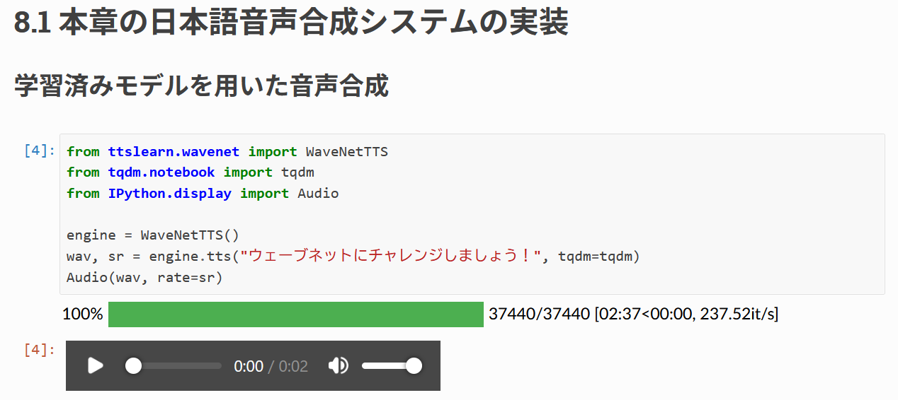
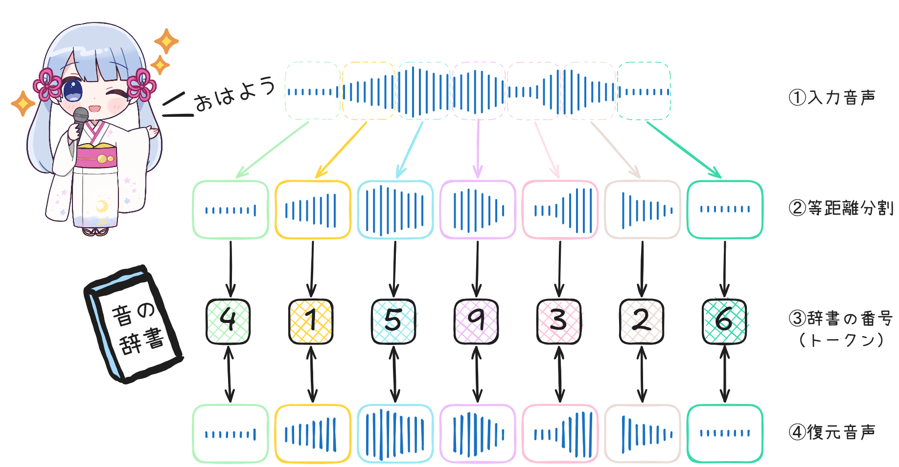

<!-- 導入 -->
**めたん**：
皆さん、こんにちは。**ゆる音声合成ワークショップへようこそ！**
本日の進行を務める、四国めたんよ。
まずは二人とも、簡単に自己紹介をお願いできるかしら。

**ずんだもん**：
ぼくはずんだもんなのだ！
音声合成も深層学習も、まだよくわかってないのだ。
学会に来るのも初めてだから、今日はとっても楽しみにしてきたのだ！

**つむぎ**：
春日部つむぎです！
普段は言語モデルのことを調べてるんだけど、音声のほうはあんまり詳しくなくて。
こういう気軽に質問できるワークショップっていいよね。よろしくお願いしまーす！

---
<!-- 言語モデルとトークン -->
**めたん**：
二人とも、ありがとう。
今回のテーマは**音声言語モデル**よ。

**つむぎ**：
言語モデルなら聞き慣れてるけど、「音声」がつくと何が変わるの？

**めたん**：
ざっくり言うと、言語モデルの仕組みを使って、音声も扱えるようにしたモデルね。
英語では Speech Language Model や Speech LLM と呼ばれることがあるわ。扱う対象や仕組みはモデルによって少しずつ違うけれど、
今日はその中でも、**音声を「トークン」の列として扱い、声を生成する仕組み**に注目するわよ。

**ずんだもん**：
待ってほしいのだ。さっそく知らない言葉が出てきたのだ。
「トークン」って何なのだ？　そもそも、言語モデルって何なのだ？

**めたん**：
そうね、まずはそこから始めましょう。
たとえば、ChatGPTのようなサービスを支えているのが、大規模言語モデル、略してLLMよ。

**ずんだもん**：
質問すると答えてくれたり、文章を書いてくれたりする、あれなのだ？

<!-- 自己回帰モデル, auto-regressive -->
**めたん**：
ええ。LLMが文章を作る仕組みの根幹にあるのは、**それまでの文章をもとに、次に続くものを予測すること**よ。
これを繰り返すことで、文章を少しずつ伸ばしていくの。

| 東京は日本の… | 仕事が… |
| :---: | :---: |
|  |  |

**つむぎ**：
たとえば「東京は日本の」という文章をLLMに与えると、その続きを予測してくれるの。
左の図だと、一番確率が高いのは「首都」。ほかにも「中心」や「都」みたいに、意味的に自然な候補が並んでるでしょ？
この中から一つ選んで文章の後ろにつなげて、また同じように続きを予測する。これを繰り返せば、文章がどんどん伸びていくってわけ。
ちなみに、最初に与える文章のことを**プロンプト**って呼ぶよ。

**ずんだもん**：
なるほど、「次に来る単語を予測する」という仕組みはわかったのだ。
でも、今の例に出てきたのは「首都」とか「中心」とか、ふつうの単語なのだ。
「トークン」とは何が違うのだ？

**つむぎ**：
実は「単語」って、けっこうあいまいな概念なんだよね。
特に日本語は単語の間にスペースがないし、どこまでを一つの単語とするかを人が全部決めるのは大変なの。
そこで、**バイト対符号化（BPE）**というアルゴリズムを使って、大量の文章から「よく一緒に出てくる文字のまとまり」を自動的に見つけて、文章を部品に分けるんだ。
この部品が**トークン**で、それぞれに番号が割り当てられてるの。
文章をトークンに分けて番号に変換する道具を、**トークナイザー**って呼ぶよ。

**めたん**：
ここで注意してほしいのは、トークンの区切りは、人間が考える単語の区切りと必ずしも一致しないということ。
たとえば「吾輩は猫である。」をトークナイザーにかけると、こんな番号の列になるわ。

**ずんだもん**：
一文字なのに、トークンが二つ以上になっているところがあるのだ！
見た目の文字数とは違うのだな。

**つむぎ**：
そうそう。あまり出てこない漢字なんかは、さらに細かく分けられちゃうこともあるんだ。
だから「何文字あるか」と「何トークンあるか」は別物なんだよね。

**ずんだもん**：
なるほど、わかってきたのだ。
文章を部品に分けて、番号に置き換えたものがトークンなのだな。

**めたん**：
その通り。
まとめると、LLMが文章を生成する流れはこうなるわ。

1. トークナイザーを使って、プロンプトをトークンの列に変換する
2. LLMで、次に来るトークンの確率を予測する
3. 予測結果の中から一つを選び、列の後ろに追加する
4. 終わりの合図が出るまで、2と3を繰り返す
5. トークナイザーを使って、トークンの列を文字列に戻す

**ずんだもん**：
つまり、文章をトークンに変えて、モデルが続きのトークンを次々に予測する。
最後にそのトークンを文字に戻すと、文章になるのだな？

**めたん**：
ええ、今日はその理解で十分よ。

---
<!-- 音声をトークンにする：なぜ工夫が必要か -->
**つむぎ**：
じゃあ、音声言語モデルも同じように考えられるの？
音声をトークンにできれば、文章の続きみたいに、音声の続きも予測できるってこと？

**めたん**：
まさに、そこが今日の話の入り口ね。

**ずんだもん**：
でも、声にも区切りがないのだ。
どこからどこまでを、一つのトークンにするのだ？

**つむぎ**：
そこ、あたしも気になる。
音声って、もともとは連続した波でしょ？　文章と同じようには区切れなさそうだけど。

**めたん**：
いいところに気づいたわね。
実は、コンピューターに保存された音声は、すでに数値の列になっているの。
波の高さをとても細かい時間間隔で測って、記録しているのよ。

**ずんだもん**：
数値の列なら、その数値をそのままトークンにすればいいのだ！

**めたん**：
実際、その方法を試した研究もあるわ。
2016年にGoogle DeepMindが発表した**WaveNet**では、この数値の一つ一つ（サンプル）を、次々と予測していく方式を使っているの。
ただし、問題は列の長さよ。たった1秒の音声でも、1万6千個もの数値が並ぶの。
文章なら、1秒で話せるのはせいぜい数トークンなのに。

**つむぎ**：
うわ、長っ！　しかも、隣り合う値ってほとんど同じだよね。無駄が多そう。

**めたん**：
そうなの。これだけ長いと、「何を話しているか」のような、長い範囲にわたるつながりをモデルが捉えにくくなるわ。それと、短い音声を生成するために結構長い時間が必要とは難点でしたよ。
WaveNetに読み上げる文章を与え、音声を生成させた例を聞いてみて。

<audio controls src="audio/waveNetJP.wav" title="WaveNet Sample"></audio>

**ずんだもん**：
悪くはないのだ

**めたん**：
それに、2秒の音声を作るのに何万回も予測を繰り返すから、二分以上時間かかっちゃった。
だから、音声をもっとコンパクトな表現に変えてから扱う必要があるのよ。

---
<!-- Neural Codec -->
**つむぎ**：
そこで、音声用のトークナイザーの出番ってわけ？

**めたん**：
そう。今回紹介するのは、**ニューラル音声コーデック（Neural Codec）**を使う方法よ。
ニューラルネットワークで音声から特徴を取り出して、それを、あらかじめ用意した候補の中から一番近いものに置き換えるの。
その候補の番号を、音声のトークンとして扱うわけね。

**つむぎ**：
なるほど。あらかじめ「声の辞書」みたいなものを用意しておいて、入力された声に一番近い項目の番号をトークンにするってことね。

**めたん**：
ええ。このように、連続的な値を限られた候補のどれかに置き換える操作を**量子化**と呼ぶの。
具体的な仕組みは、後で具体的に説明するわね。
今覚えておいてほしいのは、Neural Codecは音声を圧縮して、**連続的な音声を離散的な番号の列に置き換えられる**ということよ。

**つむぎ**：
でも、さっきの区切りの問題はどうなったの？

**めたん**：
そこは割り切って、音声を一定の時間ごとに機械的に区切るの。
たとえば1秒を数十個の区間に分けて、区間ごとにトークンを割り当てる、という具合にね。

**ずんだもん**：
1秒に1万6千個から、数十個まで減るのだ！？　ずいぶん短くなったのだ。

**つむぎ**：
でも、機械的に区切ったら、音の途中で切れちゃわない？

**めたん**：
いい質問ね。声の辞書は大量の音声から学習して作るから、区切りが音の境目とずれていても、その区間の音をうまく表せるようになっているの。
だから、意味の区切りにこだわらなくても大丈夫なのよ。

**ずんだもん**：
でも、その番号だけで、ちゃんと元の声に戻せるのだ？

**めたん**：
戻せるわよ。コーデックには、トークンの列から音声を復元する仕組みもセットになっているの。
ただし、圧縮するときに情報の一部を省いているから、元の波形とまったく同じになるとは限らないわ。
フリー素材キャラクター「つくよみちゃん」の、無料公開されている音声データで試してみたわ。
まずは元の音声よ。

<audio controls src="audio/VOICEACTRESS100_001.wav" title="つくよみちゃん"></audio>

次に、いったんトークンに変換してから、復元した音声よ。

<audio controls src="audio/reconstruct.wav" title="つくよみちゃん復元"></audio>

**ずんだもん**：
少しだけ違和感はあるけど、ちゃんと同じ声で、同じ言葉に聞こえるのだ！

**つむぎ**：
テキストのトークナイザーとは、作り方がけっこう違うんだね。
テキストだとBPEみたいに、ニューラルネットワークを使わない方式が多いし。

**めたん**：
そうね。「トークナイザー」という役割は同じでも、中身まで同じとは限らないの。
でもイメージ的には、両方ども、大量のデータからパターンを自動的に抽出するになるわ。

---
<!-- 音声トークンの生成とTTS -->
**ずんだもん**：
でも、音声を番号に変えただけでは、まだ新しい声は作れないのだ？

**めたん**：
その通り。そこで言語モデルの出番よ。
文章のトークンを予測するのと同じように、**音声のトークンを予測するようにモデルを学習させる**の。
そして、生成したトークンをコーデックで音声に戻すのよ。
流れは、さっきの文章の場合とほとんど同じね。

1. Neural Codecを使って、入力の音声（プロンプト）をトークンの列に変換する
2. 言語モデルで、次に来る音声トークンを予測する
3. 予測結果の中から一つを選び、列の後ろに追加する
4. 終わりの合図が出るまで、2と3を繰り返す
5. Neural Codecを使って、トークンの列を音声に戻す

**ずんだもん**：
トークナイザーがNeural Codecに入れ替わっただけなのだ！

**つむぎ**：
じゃあ、プロンプトに読み上げたい文章も一緒に入れて、その文章に合う音声トークンを生成させれば……。

**めたん**：
文章から音声を作る、**音声合成（TTS）**につながるわ。
もちろん、文章と音声をどう対応づけるかなど、工夫は必要だけれどね。

**ずんだもん**：
おお、やっと話がつながったのだ！
文章を渡すと、モデルが声のもとになるトークンを作って、それをコーデックで実際の声に戻すのだな。

**めたん**：
ええ、それが今回紹介する方式の大きな流れよ。

**つむぎ**：
トークンの列として扱えるなら、言語モデルで使われてるモデルの構造や学習方法も応用できそうだね。

**めたん**：
その通り。今回は、言語モデルの研究でよく使われる、
お手本となる正解データで追加学習する**教師ありファインチューニング、SFT**と、二つの出力のうちどちらが好ましいかを比べたデータで学習する**直接選好最適化、DPO**も紹介する予定よ。

**ずんだもん**：
またアルファベットが増えたのだ……。
今、全部覚えないとだめなのだ？

**めたん**：
大丈夫。今は「声の作り方を学ぶ方法と、出てくる声をもっと良くする方法がある」くらいに思っておいて。
まずはNeural Codec、その次にモデルの学習方法。この順番で進めるわ。

**つむぎ**：
ちなみに、TransformerとかSelf-Attentionの仕組みも説明するの？
そこから始めると、かなり長くなりそうだけど。

**めたん**：
今回は、言語モデルの内部構造には深入り**しない**予定よ。
その代わり、**音声をどうトークンに変えるのか、どう生成して声に戻すのか**を、じっくり見ていきましょう。

**ずんだもん**：
じゃあ、ひとまず言語モデルは「与えられたトークンの列をもとに、次のトークンを予測するもの」と考えておけばいいのだな。

**めたん**：
ええ、今日の入り口としては、それで十分よ。

**つむぎ**：
あたしは、音声のトークンにどんな情報が入ってるのか気になるな。
話してる内容だけじゃなくて、声の高さとか話し方も表せるんでしょ？

**めたん**：
いい質問ね。そこも音声を扱う面白さの一つよ。
次のセクションで、実際の例を見ながら紹介するわね。

**ずんだもん**：
楽しみなのだ！
……でも、その前に休憩なのだ？

**めたん**：
ええ、ここで少し休憩にしましょう。
ここまでで気になることがあれば、遠慮なく声をかけてね。次のセクションで、また会いましょう！

**つむぎ**：
はーい！　おやつ食べながら、さっきの話もちょっと聞かせてよ。

**ずんだもん**：
賛成なのだ！　

参考文献

- https://platform.openai.com/tokenizer
- https://spark-journal.kddi.com/tsunagu/ts1458/
- van den Oord et al., "WaveNet: A Generative Model for Raw Audio", 2016. https://arxiv.org/abs/1609.03499
- https://r9y9.github.io/ttslearn/latest/index.html
- https://tyc.rei-yumesaki.net/
<!-- TODO: つくよみちゃんコーパスの利用規約に沿ったクレジット表記を追加 -->