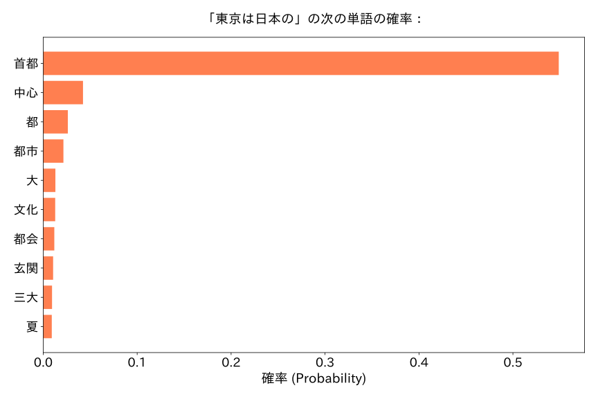
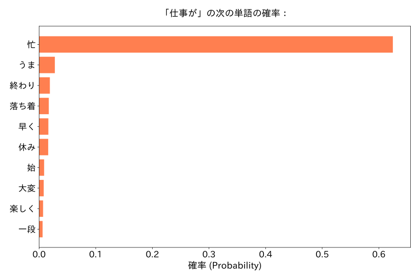
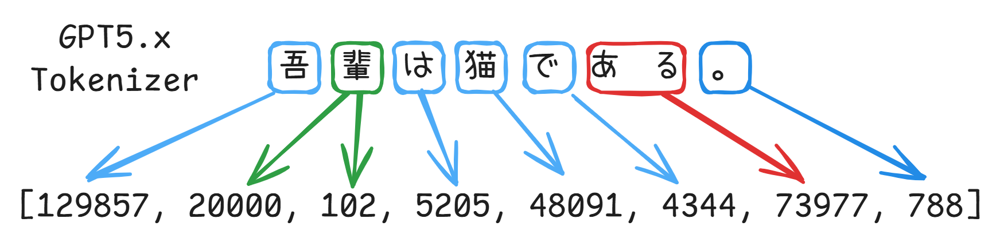

**めたん**：
皆さん、こんにちは。**ゆる音声合成ワークショップへようこそ！**
本日の進行を務める、四国めたんです。
まずは、簡単に自己紹介をお願いできるかしら。

**ずんだもん**：
ぼくはずんだもんなのだ！
音声合成も深層学習も、まだよくわかってないのだ。
学会に来るのも初めてだから、今日は楽しみにしてきたのだ！

**つむぎ**：
春日部つむぎです！
普段は言語モデルのことを調べてるんだけど、音声のほうはあんまり詳しくなくて。
こういう、気軽に質問できるワークショップっていいよね。よろしくお願いしまーす！

**めたん**：
二人とも、ありがとう。
それなら今日は、言語モデルを知っている人にも、これから学ぶ人にも伝わるように進めていきましょう。
今回のテーマは、**音声言語モデル**よ。

**つむぎ**：
言語モデルなら聞き慣れてるけど、「音声」がつくと何が変わるの？

**めたん**：
ざっくり言うと、言語モデルの仕組みを使って、音声も扱うモデルね。
英語では Speech Language Model や Speech LLM と呼ばれることがあるわ。ただ、扱う対象や仕組みはモデルによっては若干違うところがあるけれど。
今日はその中でも、**音声を「トークン」の列として扱い、声を生成する仕組み**に注目するわよ。

**ずんだもん**：
待ってほしいのだ。さっそく知らない言葉が出てきたのだ。
「トークン」とはなに？そもそも、言語モデルって何なのだ？

**めたん**：
そうね、まずはそこから始めましょう。
例えば、ChatGPTのようなサービスを支えているのが、大規模言語モデル、略してLLMよ。

**ずんだもん**：
質問すると答えてくれたり、文章を書いてくれたりする、あれなのだ？

**めたん**：
ええ。その文章を作る仕組みの根幹にあるのは、**それまでの文章をもとに、次に続くトークンを予測すること**よ。
それを繰り返すことで、文章を伸ばしていくの。

| 東京は日本の… | 仕事が… |
| :---: | :---: |
|  |  |

**つむぎ**：
例えば、「日本は東京の」という文書を前提条件としてLLMに提供する。LLMがその続ぎを予測してくれるから、この図の左のように、「首都」が一番確率が高い選択肢で、「中心」や「都」など、意味合い的にあっている接続も出てくるのよ。その中から一つを選らんて、また同じ操作を回すことにより、文書がどんどん伸ばせるってわけ。ちなみに、ここの前提条件として文書というのは、よくプロンプトと呼ぶの。

**ずんだもん**：
なるほど、「次の単語を予測する」という仕組みは理解した。
じゃここは「トークン」とはなんなの？
ここに使っているのは単語でしょう？

**つむぎ**：
それは、「単語」という概念があいまいでね、どこまでが一つの単語なのか手作業で指定するのは難しいのよ。
だから、「バイト対符号化」アルゴリズムを使って、自動的に文章をその部品に分けて、「単語」たちに番号を当てつけるということなの。
そして、文書の中の単語を、それぞれに対応する番号へ変換するのが、**トークナイザー**よ。

**めたん**：
トークンの区切りは、人間が考える単語の区切りと必ずしも一致しないの。
例えば、「吾輩は猫である。」の場合、こんな番号にはなるけど。

**ずんだもん**：
一文字なのに、トークンが二つ以上になることもあるのか！
見た目の文字数とは違うのだな。

**つむぎ**：
そうそう。だから「何文字あるか」と「何トークンあるか」は別なんだよね。

**ずんだもん**：
なるほどわかってきたぞ。
文章を部品に分けて、番号に置き換えるのだな。

**めたん**：
その通り。
文書を生成するにあったて、大まかなプロセスはこうなの。
1. プロンプトをトークンに変換する、トークナイザーを使って
2. LLMを使って、新しいトークンを予測する。
3. 予測結果の中に一つを選び、プロンプトに追加する
4. 操作２と３を終わるまで繰り返す
5. 結果をトークナイザーを使って、文字列に戻す

**ずんだもん**：
だんだんわかってきたのだ。
文章をトークンに変えて、モデルが続きの番号を予測する。出てきた番号、すなわちトークンを文字に戻すと、文章になるのだな？

**めたん**：
ええ、ここではその理解で十分よ。

---

**つむぎ**：
じゃあ、音声言語モデルも同じように考えられるの？
音声をトークンにできれば、文章の続きみたいに、音声の続きも予測できるってこと？

**めたん**：
まさに、そこが今日の話の入り口ね。

**ずんだもん**：
でも、声には文字みたいな区切りがないのだ。
どこからどこまでを、一つのトークンにするのだ？

**つむぎ**：
そこ、あたしも気になる。
音声って、もともとは連続した波でしょ？　文章と同じようには区切れなさそうだけど。

**めたん**：
いいところに気づいたわね。
コンピューターに保存した音声は、すでに細かい時間間隔で測った数値の列になっているわ。
その数値の列をそのままトークンとして使えなくもないが、ただ、列がとても長くなって、効果が悪くなるの。

**つむぎ**：
確かに、冗長性しかない序列に見えるわね

**めたん**：
グーグルが2016年に発表された、WaveNetという研究があって。
そこで使われたのは、サンプルごとをトークンとしてみなす方式よ。
しかし、実際の出来はこうなのよ

<audio controls src="audio/waveNet.wav" title="WaveNet Sample"></audio>

**ずんだもん**：
なんだこりゃ、英語はこんなんでしたっけ。

**めたん**：
だから今回は、音声をもっとコンパクトな表現に変える仕組みを使うわよ。

**つむぎ**：
音声用のトークナイザーの出番なのだ？

**めたん**：
そう。今回紹介するのは、**ニューラル音声コーデック、Neural Codec**を使う方法よ。
ニューラルネットワークで音声の特徴を取り出し、それを、あらかじめ用意した候補の中から選ぶ形に置き換えるの。
その候補を表す番号を、音声のトークンとして扱うわけね。

**つむぎ**：
なるほど。音の特徴を、そのまま細かい数値で持っておくんじゃなくて、「一番近いの候補」の番号で表すんだ。

**めたん**：
ええ。このように、値を限られた候補に置き換える操作を「量子化」と呼ぶの。
具体的な仕組みは、後で図を見ながら説明するわね。

**ずんだもん**：
その番号から、ちゃんと声に戻せるのだ？

**めたん**：
戻せるわよ。コーデックには、トークンの列から音声を復元する仕組みもあるの。
ただし、圧縮するときに情報を省くので、元の波形と完全に同じになるとは限らないわ。

**ずんだもん**：
なるほどなのだ。
音声をトークンに変える仕組みと、トークンを音声に戻す仕組みが、セットになっているのだな。

**つむぎ**：
テキストのトークナイザーとは、作り方がけっこう違うんだね。
テキストではBPEとか、ニューラルネットワークを使わない方式もよく使うから。

**めたん**：
そうね。「トークナイザー」という役割は似ていても、その中身まで同じとは限らないの。

**ずんだもん**：
でも、音声を番号に変えただけでは、まだ新しい声は作れないのだ？

**めたん**：
その通り。そこで、言語モデルの出番よ。
文章のトークンを予測するのと同じように、**音声のトークンを予測するようにモデルを学習させる**の。
そして、生成したトークンをコーデックで音声に戻すのよ。

**つむぎ**：
じゃあ、読み上げたい文章も一緒に与えて、その文章に合う音声トークンを生成させれば……。

**めたん**：
文章から音声を作る、**音声合成、TTS**につながるわ。
もちろん、文章と音声をどう対応づけるかなど、工夫は必要だけれどね。

**ずんだもん**：
おお、やっと話がつながったのだ！
文章を渡すと、モデルが声のもとになるトークンを作って、それを実際の声に戻すのだな。

**めたん**：
ええ、それが今回紹介する方式の大きな流れよ。

**つむぎ**：
トークンの列として扱えるなら、言語モデルで使われているモデルの構造や、学習の方法も応用できそうだね。

**めたん**：
その通り。音声に合わせた調整は必要だけれど、言語モデルの研究で使われてきた手法を生かせるの。
今回は、正解の例を使って追加学習する**SFT**と、出力の好ましさを比べたデータで学習する**DPO**も紹介する予定よ。

**ずんだもん**：
またアルファベットが増えたのだ……。
今、全部覚えないとだめなのだ？

**めたん**：
大丈夫。今は「声の作り方を学ぶ方法や、出てくる声を改善する方法がある」くらいに思っておいて。
まずは音声の基礎、その次にNeural Codec、最後にモデルの学習方法。この順番で進めるわ。

**つむぎ**：
ちなみに、TransformerとかSelf-Attentionの仕組みも説明するの？
そこから始めると、かなり長くなりそうだけど。

**めたん**：
今回は、言語モデルの内部構造には深入りしない予定よ。
その代わり、**音声をどうトークンに変えるのか、どう生成して声に戻すのか**を、じっくり見ていきましょう。

**ずんだもん**：
じゃあ、ひとまず言語モデルは「与えられた情報をもとに、次のトークンを予測するもの」と考えておけばいいのだな。

**めたん**：
ええ、今日の入り口としては、それで十分よ。

**つむぎ**：
あたしは、音声のトークンにどんな情報が入ってるのか気になるな。
話してる内容だけじゃなくて、声の高さとか、話し方も表せるんでしょ？

**めたん**：
いい質問ね。そのあたりも、音声を扱う面白さの一つよ。
続きのセクションで、実際の音も聴きながら確かめてみましょう。

**ずんだもん**：
それは楽しみなのだ！
……でも、その前にバンケットなのだ？

**めたん**：
ええ、まずはお食事と交流の時間よ。
ここまでで気になることがあれば、遠慮なく声をかけてね。次のセクションで、また会いましょう！

**つむぎ**：
はーい！　ご飯を食べながら、さっきの話もちょっと聞かせてよ。

**ずんだもん**：
賛成なのだ！　まずはおなかを満たして、続きに備えるのだ！

参考文献

- https://platform.openai.com/tokenizer