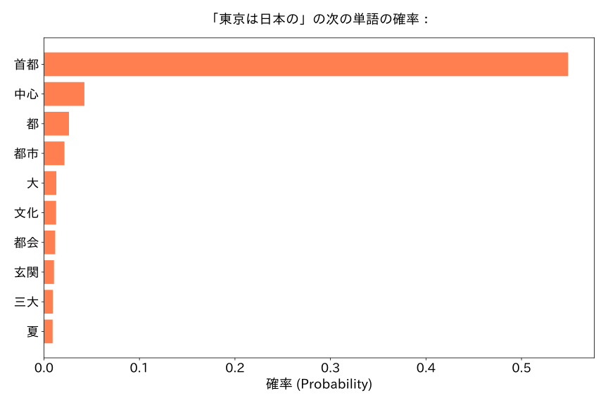
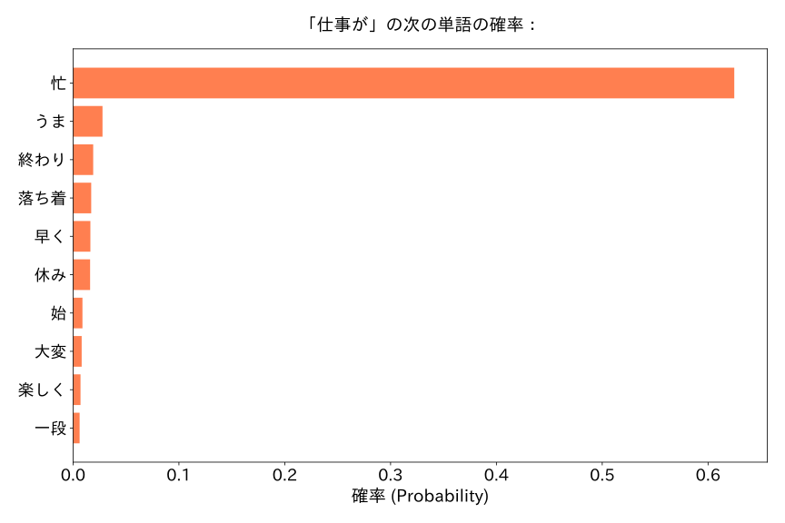
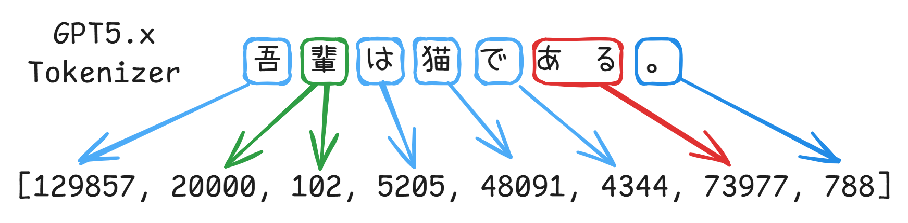
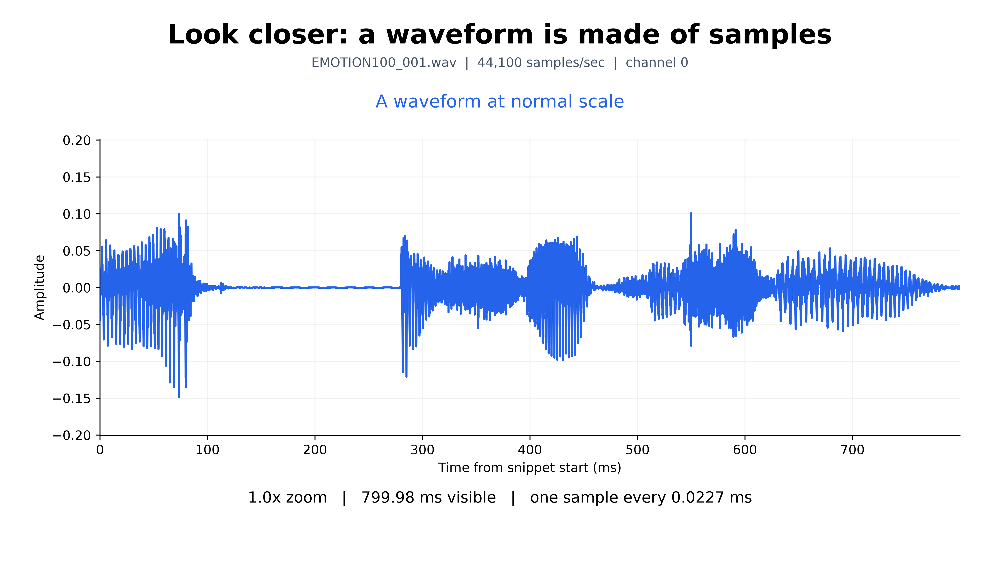
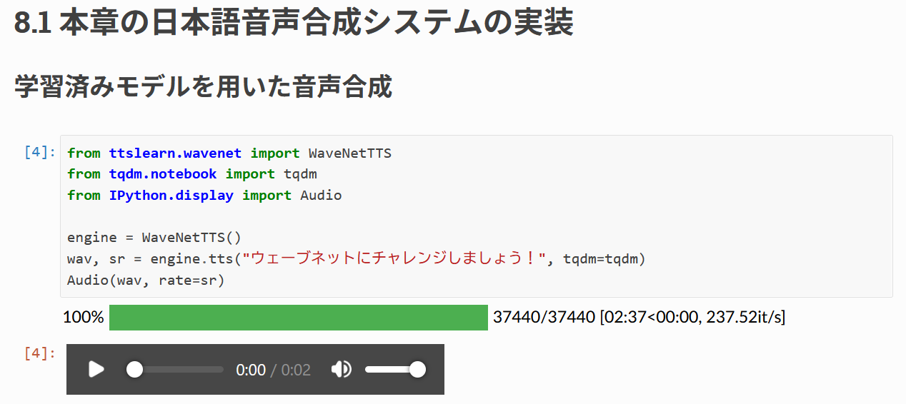
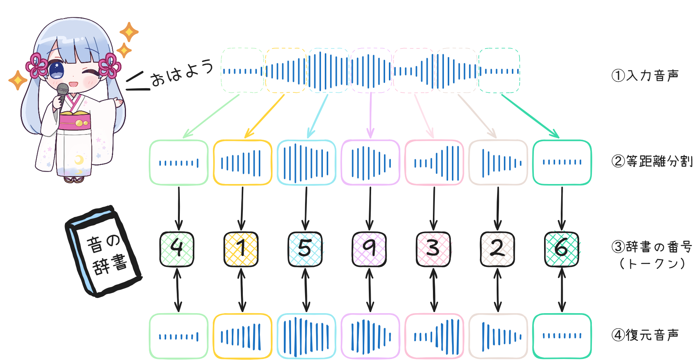

<!-- 導入 -->

**めたん**：
皆さん、こんにちは。**ゆる音声合成ワークショップへようこそ！**
本日の進行を務める、四国めたんよ。

**ずんだもん**：
ずんだもんなのだ！ 音声合成も深層学習も初心者だけど、よろしくお願いしますなのだ！

**つむぎ**：
春日部つむぎです！ 普段は言語モデルを調べてるんだけど、音声は初めて。
気軽に質問させてもらうね！

---
<!-- 言語モデルとトークン -->
**めたん**：
<!-- 英語では Speech Language Model や Speech LLM と呼ばれることがあるわ。 板書 -->
今回のテーマは**音声言語モデル**よ。
言語モデルならもう聞きなれたと思うので、音声言語モデルは、
ざっくり言うと、言語モデルの仕組みを使って、音声も扱えるようにしたモデルなの。

**つむぎ**：
なるほど、単純な発想だが、理にかなっている。

**めたん**：
今日はその、**音声を「トークン」の列として扱い、声を生成する仕組み**に注目するわよ。

**ずんだもん**：
さっそく知らない言葉が出たのだ。「言語モデル」とか「トークン」って何なのだ？

**めたん**：
<!-- AR -->
まずは言語モデルから整理しましょう。
ChatGPTのようなサービスを支えているのが、大規模言語モデル、略してLLMよ。
LLMが文章を作るとき、それまでの文章をもとに、次に来る単語を確率で予測してつなげてくれる。
これを繰り返すことで、文章を少しずつ伸ばしていくの。

| 東京は日本の… | 仕事が… |
| :---: | :---: |
|  |  |

**つむぎ**：
<!-- 板書：プロンプト -->
たとえば左の図みたいに「東京は日本の」という最初の文章を与えると、次に続く候補として「首都」「中心」「都」などの確率を予測してくれるんだ。
この中から一つを選んで後ろにくっつけば、また続きを予測するのを繰り返すんだよ。
ちなみに、最初に与える文章のことを**プロンプト**って呼ぶよ。

**ずんだもん**：
なるほど。「首都」みたいに、次に来る単語を予測するのだな？ 
それなら「トークン」とは？

**つむぎ**：
実は「単語」って、けっこうあいまいな概念なんだよね。
特に日本語は単語の間にスペースがないし、どこまでを一つの単語とするかを手動で全部決めるのは大変なの。
そこで、**バイト対符号化（BPE）**というアルゴリズムを使って、大量の文章から「よく一緒に出てくる文字のまとまり」を自動的に見つけて、文章を部品に分けるんだ。
この部品が**トークン**で、それぞれに番号が割り当てられてるの。
文章をトークンに分けて番号に変換する道具を、**トークナイザー**って呼ぶよ。

**めたん**：
ここで注意してほしいのは、トークンの区切りは、人間が考える単語の区切りと必ずしも一致しないということ。
たとえば「吾輩は猫である。」をトークナイザーにかけると、こんな番号の列になるわ。

**ずんだもん**：
一文字なのに、トークンが二つ以上になっているところがあるのだ！
見た目の文字数とは違うのだな。

**つむぎ**：
そうそう。あまり出てこない漢字なんかは、さらに細かく分けられちゃうこともあるんだ。
「何文字あるか」と「何トークンあるか」は別物とは言え、おおむね「トークン」とは別の形式の単語として認識しても構わないわ。

**ずんだもん**：
なるほど、文章を番号の列に変えるのだな。……
でも、ただの番号を使ってどうやって次を予測するのだ？ 今のAIの賢さが番号の予測だけでは説明がつかんだろう。

**めたん**：
いいところに気づいたわね。トークンの番号自体はただの名札だから、そのまま計算には使わないの。
モデルに入力するとき、それぞれの番号を「意味や特徴を表すベクトル」に変換するわ。これを埋め込みと呼ぶのよ。

つむぎ：
それらのベクトルの空間は、意味が似ているトークン同士が近くに配置されるように作られ、
モデルの内部ではその高次元ベクトル空間の中で文脈を計算しながら、次に来るトークンを予測してるんだ。
その空間のこと、潜在空間とも言うんだ。

**めたん**：
その通り。細かい計算の中身までは今日深入りしないけれど、
「どんなトークンでも、一旦潜在空間に投影し、潜在空間で系列の続きを予測する」とイメージしておくと、
後で音声を扱うときにも見通しが良くなるわ。

まとめると、LLMが文章を生成する流れは次の5ステップになるわ。

1. トークナイザーを使って、プロンプトをトークンの列に変換する
2. トークンをベクトルに変え、LLMで次に来るトークンの確率を予測する
3. 予測結果の中から一つを選び、列の後ろに追加する
4. 終わりの合図が出るまで、2と3を繰り返す
5. トークナイザーを使って、トークンの列を文字列に戻す

**ずんだもん**：
つまるところ、文章をトークンに変えて、高次元ベクトルの世界で続きを予測して、最後に文字に戻すのだな。
よくわかったのだ！

**めたん**：
ええ、今日はその理解で十分よ。

---
<!-- 音声をトークンにする：なぜ工夫が必要か -->
**つむぎ**：
じゃあ、音声もトークンの列にできれば、同じ仕組みで音声の続きを予測できるってこと？

**めたん**：
まさにそこが今日の本題よ。

**ずんだもん**：
でも、声は連続した波だし、文字みたいに区切りがないのだ。どうやって番号の列にするのだ？

**めたん**：
実は、コンピューターに保存された音声は、すでに数値の列になっているの。
波の高さをとても細かい時間間隔で測って記録しているのよ。
これらの数値は、サンプルともいう、一秒の間何個のサンプルを取るかをサンプリング周波数をいう。

**ずんだもん**：
数値の列なら、その数値をそのままトークンにすればいいのだ！

**めたん**：
実際、その方法を試した研究もあるわ。
2016年にGoogle DeepMindが発表した**WaveNet**では、サンプル一つ一つを、次々と予測していく方式を使っているの。
ただし、当時に採用されたサンプリング周波数が１万６千ヘルツでしたので、1秒の音声を生成するために、一万回モデルを回さないといけないのよ。

**つむぎ**：
うわ、長っ！　モデルが「何を話しているか」みたいな長い文脈を捉えにくそうだし、生成もすごく時間がかかりそう。

**めたん**：
その通り。実際にWaveNetに文章を与えて生成した音声を聞いてみて。

<audio controls src="audio/waveNetJP.wav" title="WaveNet Sample"></audio>

**ずんだもん**：
悪くはないのだ

**めたん**：
音質は悪くないけれど、この2秒の音声を作るために何万回も予測を繰り返したから、生成に2分以上かかってしまったの。
より効率よく生成したいには、音声のサンプルをそのまま扱うのではなく、もっと短いトークン列に圧縮してから扱う工夫が必要になるのよ。

---
<!-- Neural Codec -->
**つむぎ**：
そこで、音声用のトークナイザーの出番ってわけ？

**めたん**：
そう。今回紹介するのは、**ニューラル音声コーデック**を使う方法よ。

**ずんだもん**：
具体的に、どうやるんだ？

**めたん**：
ざっくりいうと、あらかじめ音声の辞書を用意するの。
番号に置き換えるときに、音声をまず機械的に区切って、各区間を逐一に辞書を照合し、その中から一番似ているやつの番号を引いて、トークンとして使うの。
さらに、番号から音を作り直す場合は、辞書からその番号が対応する音声の断片をくっつけばよいのよ。

**ずんだもん**：
なるほど。あらかじめ「音声の辞書」みたいなものを用意しておいて、入力された声に一番近い項目の番号をトークンにするってことね。

**つむぎ**:
やりたいことはわからなくもないが、これって、番号から完全に音を復元することはできないでしょう。

<!-- 要修正 -->
**めたん**：
ええ。復元できるのは、あくまで似た声だけ。
完全に復元したい場合、その「音の辞書」の中に、この世のすべての音のパターンを全部網羅しないといけないので、とても現実的ではないの。
しかし、現実問題、音声のデータが少しだけの誤差があっても、人間の耳にとっては、ほとんど感知できないわ。
そこで、似た音声の断片をひとくくりにして、一つとしてあらわすの。これは量子化という。

**つむぎ**:
なるほど、イメージ的には、実数で記録したデータを、整数の精度まで落とし込むって感じかな？
やや精度が落ちるけど、記録に必要な容量がだいぶ削減できるわね。

**めたん**：
今覚えておいてほしいのは、Neural Codecは音声を圧縮して、**連続的な音声を離散的な番号の列に置き換えられる**ということよ。
ニューラル音声コーデックを使う場合、先ほどの音声を三十個の音声トークンで表せるの。

**ずんだもん**：
1秒に1万6千個から、数十個まで減るのだ！？　ずいぶん短くなったのだ。

**ずんだもん**：
でも、その番号だけで、ちゃんと元の声に戻せるのだ？

**めたん**：
つくよみちゃんの音声データで試してみたわ。
まずは元の音声よ。

<audio controls src="audio/VOICEACTRESS100_001.wav" title="つくよみちゃん"></audio>

次に、いったんトークンに変換してから、復元した音声よ。

<audio controls src="audio/reconstruct.wav" title="つくよみちゃん復元"></audio>

**ずんだもん**：
少しだけ違和感はあるけど、ちゃんと同じ声で、同じ言葉に聞こえるのだ！

**めたん**：
テキストのトークナイザーとは中身がぜんぜん違うけど、「大量のデータからパターンを学習して番号に置き換える」という役割は同じなんだわ。

---
<!-- 音声トークンの生成とTTS -->
**ずんだもん**：
これで音声をトークンにできたのだ。いよいよ声を作る番なのだな？

**めたん**：
その通り。そこで言語モデルの出番よ。
文章のトークンを予測するのと同じように、**音声のトークンを予測するようにモデルを学習させる**の。
そして、生成したトークンをコーデックで音声に戻すのよ。
流れは、さっきの文章の場合とほとんど同じね。

1. Neural Codecを使って、入力の音声（プロンプト）をトークンの列に変換する
2. 言語モデルで、次に来る音声トークンを予測する
3. 予測結果の中から一つを選び、列の後ろに追加する
4. 終わりの合図が出るまで、2と3を繰り返す
5. Neural Codecを使って、トークンの列を音声に戻す

**ずんだもん**：
トークナイザーがNeural Codecに入れ替わっただけなのだ！

**つむぎ**：
じゃあ、プロンプトに読み上げたい文章も一緒に入れて、その文章に合う音声トークンを生成させれば……。

**めたん**：
文章から音声を作る、**音声合成（TTS）**につながるわ。
もちろん、文章と音声をどう対応づけるかなど、工夫は必要だけれどね。

**ずんだもん**：
おお、やっと話がつながったのだ！
文章を渡すと、モデルが声のもとになるトークンを作って、それをコーデックで実際の声に戻すのだな。

**めたん**：
ええ、それが今回紹介する方式の大きな流れよ。

**つむぎ**：
トークンの列として扱えるなら、言語モデルで使われてるモデルの構造や学習方法も応用できそうだね。

**めたん**：
その通り。言語モデルの研究でよく使われる、
お手本となる正解データで追加学習する**教師ありファインチューニング**や、**直接選好最適化、DPO**も全部そのまま使えるよ。

**ずんだもん**：
またアルファベットが増えたのだ……。
今、全部覚えないとだめなのだ？

**めたん**：
大丈夫。今は「声の作り方を学ぶ方法と、出てくる声をもっと良くする方法がある」くらいに思っておいて。
まずはNeural Codec、その次にモデルの学習方法。この順番で進めるわ。

**つむぎ**：
ちなみに、TransformerやSelf-Attentionの内部構造も説明するの？

**めたん**：
今回は、言語モデルの内部構造には深入り**しない**予定よ。
その代わり、**音声をどうトークンに変えるのか、どう生成するのか**を、じっくり見ていきましょう。

**ずんだもん**：
じゃあ、ひとまず言語モデルは「与えられたトークンの列をもとに、次のトークンを予測するもの」と考えておけばいいのだな。

**めたん**：
ええ、今日の入り口としては、それで十分よ。

**つむぎ**：
あたしは、音声のトークンにどんな情報が入ってるのか気になるな。
話してる内容だけじゃなくて、声の高さとか話し方も表せるんでしょ？

**めたん**：
いい質問ね。そこも音声を扱う面白さの一つよ。
次のセクションで、実際の例を見ながら紹介するわね。

**ずんだもん**：
楽しみなのだ！
……でも、その前に休憩なのだ？

**めたん**：
ええ、ここで少し休憩にしましょう。
ここまでで気になることがあれば、遠慮なく声をかけてね。次のセクションで、また会いましょう！

**つむぎ**：
はーい！　おやつ食べながら、さっきの話もちょっと聞かせてよ。

**ずんだもん**：
賛成なのだ！　

参考文献

- https://platform.openai.com/tokenizer
- https://spark-journal.kddi.com/tsunagu/ts1458/
- van den Oord et al., "WaveNet: A Generative Model for Raw Audio", 2016. https://arxiv.org/abs/1609.03499
- https://r9y9.github.io/ttslearn/latest/index.html
- https://tyc.rei-yumesaki.net/
<!-- TODO: つくよみちゃんコーパスの利用規約に沿ったクレジット表記を追加 -->