## 「スマホから聞こえる相手の声は、実は本人の声ではない」
めたん：突然ですが、「スマホから聞こえる相手の声は、本人の声そのものではない」って知ってた？
 
ずんだもん：どういうことなのだ？ しゃべってるのは本人なのだ。


めたん：実は電話線にそのまま声を乗せるのはできないから、糸電話みたく、マイクに入った声そのものを送ってるではないです。
 
つむぎ： いったん電気で表現できるような信号に変換するってことよね。
 
めたん：その通りです。声がよりコンパクトな符号に変換されてから送られ、受け取った側でその符号から「合成音声」を作って流します。だから電話越しに聞こえたのはあくまでも「符号から合成した声」で、厳密には「本人によく似た他人の声」なんです。
 
ずんだもん：電話の声って音質が悪いもんね。符号化した際に、情報が削られてるからなんだ。でも、「本人じゃない！」って思ったことはないのだ。
 
めたん：そこが面白いところです。多少音質が落ちても、私たちは本人の声として受け入れます。音楽ならなおさらで、MP3とFLACを聞き分けられる人はほとんどいません。
 
つむぎ：確かに配信サービスの「ロスレス」になっているかどうかは結構微妙だよな。
 
めたん：ええ、人間に聞こえにくい情報を捨てて、通信量を節約しても、ほとんどの人は気づきません。
 
ずんだもん：人間の感覚って、意外と大ざっぱなんだな。
 
めたん：目も同じです。この3つの黄色、見分けられますか？
 
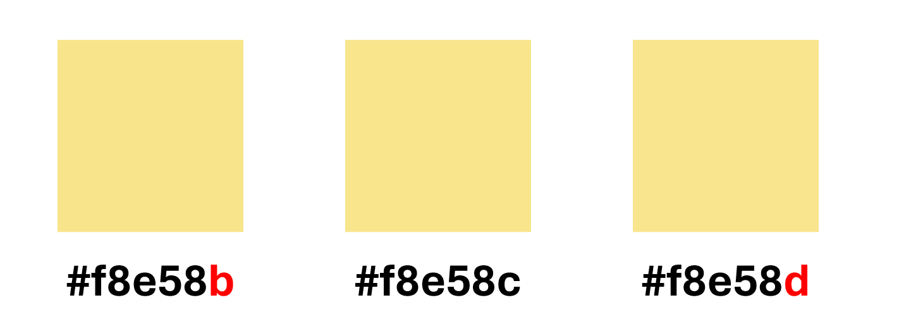
 
めたん：視聴者が特別色の見分けがいいじゃない限り、連続的な色を限られた色のどれかで代用しても困りません。これを「量子化」と呼びます。昔の8bitカラーは、すべての色を256色に置き換えてデータ量を抑えていました。
 
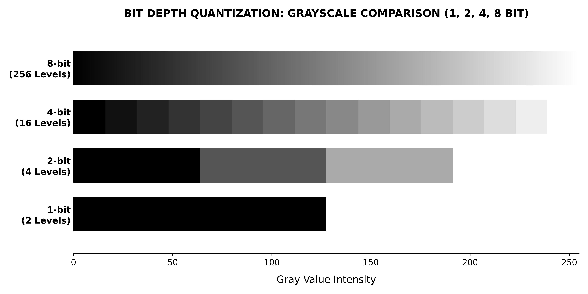
 
つむぎ：音声も同じといいたいよね。多少の誤差なら、人間の耳はほとんど気づかないっと。
 
めたん：その通りです。この性質を利用して、情報量を大胆に削ったのが「Neural Codec」です。
 
## Neural Codec

ずんだもん：そもそもCodecってなんなの？

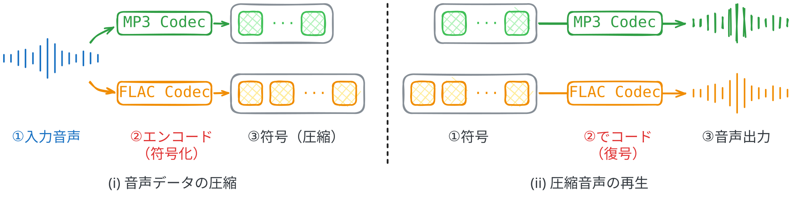

つむぎ：Codecとは、データを符号に変換したり、符号からデータを復元するための装置よ。例えば前に出てきた「MP3」や「FLAC」は音楽においての有名Codecで、画像において「Jpeg」なども有名です。


めたん：Neural Codecは、深層学習を使ったCodecです。従来の手法とは圧縮性能が桁違いなんです。実際に聞き比べてみましょう。まずは原音から。

<audio controls src="../chaps/assets/chap2_tokenizer/audio/reference_48k.wav" title="Title"></audio>

めたん：次に、ネット通話でよく使われる従来型のCodec「Opus」を、Neural Codecの一つであるMimiと同じくらいのビットレート（約5kbps）まで落とすと、こうなります。

<audio controls src="../chaps/assets/chap2_tokenizer/audio/opus_2.2k.wav" title="Title"></audio>

ずんだもん：うわ、ガビガビで何を言ってるのか分からないのだ！

めたん：では、同じくらいのビットレートでMimiを使うと……

<!-- TODO: Mimiで圧縮・復元した音声のパスを入れる -->
<audio controls src="../chaps/assets/chap2_tokenizer/audio/qwen3_48k.wav" title="Title"></audio>

ずんだもん：ほとんど元の声と同じなのだ！ どうやってるのだ？

めたん：実はVQVAEという手法を使って…

つむぎ：はいはいはい、それはよく画像生成にも用いられる手法だよね。


### VQ-VAE


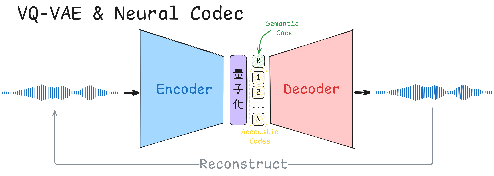

つむぎ：VQ-VAEは、ペアになった2つのモデルでできてるの。1つ目の**エンコーダー**がデータを短い符号に変換して、2つ目の**デコーダー**が符号から元のデータを復元する。その間に**量子化**をはさんで、符号を「番号」、つまり離散的なトークンにしちゃうって感じかな。

めたん：言葉だけだと分かりにくいですから、画像の例で見てみましょう。

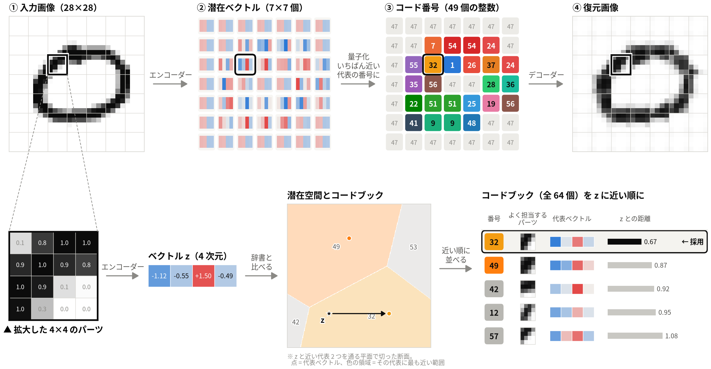

つむぎ：MNISTの手書き数字でやってみるね。まず、28×28の画像を4×4の小さなパーツに切り分ける。縦7個×横7個で、全部で49個になるよ。次に、エンコーダーが各パーツを1本の短いベクトルに変換する。最後に、そのベクトルを「よく出てくる代表的なパターン」のうちいちばん似ているものに置き換えて、その番号だけを残すの。

そうすると、28×28＝784ピクセルの画像が、たった49個の整数で表せちゃうってわけ。図の真ん中を見てね。何も書かれていない背景のパーツは、全部同じ「22番」になってるでしょ？

めたん：その代表パターンの一覧が、前にお話しした「辞書」です。専門用語では**コードブック**と呼びます。

仕組みを整理すると、こうなります。

1. エンコーダーが、データを「潜在空間」と呼ばれるベクトルの空間に写す。
2. 潜在空間の中に代表点（コードブック）をいくつか用意して、各ベクトルをいちばん近い代表点に置き換える。
3. デコーダーが、代表点から元のデータを復元する。

このとき潜在空間は「どの代表点にいちばん近いか」で区切られるので、ボロノイ図のような形になります。

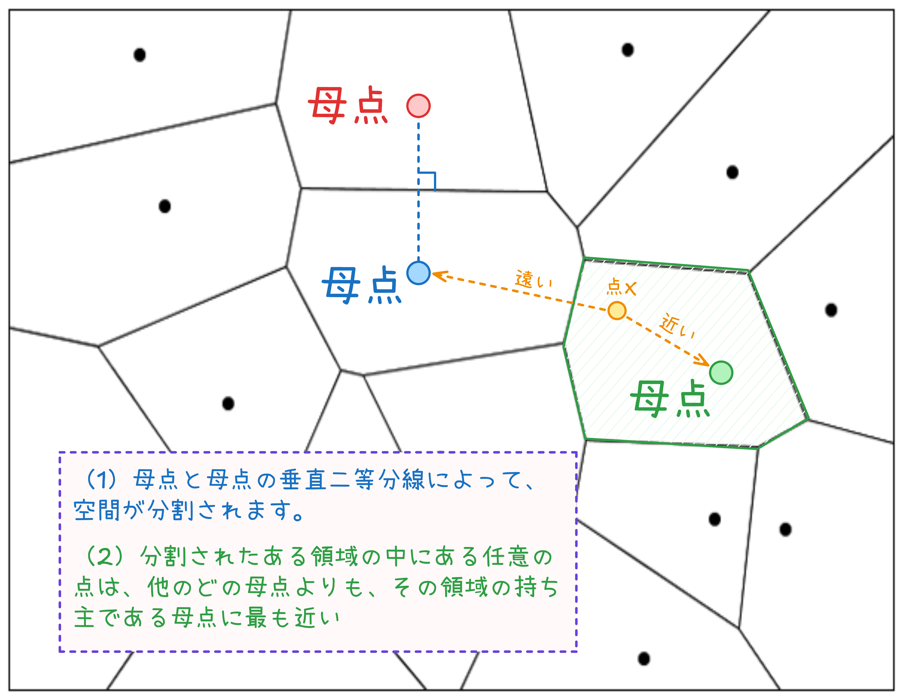

ポイントは、代表点を人の手で選ぶ必要がないことです。エンコーダーもデコーダーもコードブックも、すべてデータから自動的に学習されます。実際に学習のプロセスを回して、こうなるはず

<video  controls>
  <source src="../chaps/assets/chap2_tokenizer/learningVqvae.mp4" type="video/mp4">
</video>

めたん：ちなみに音声の場合も考え方は同じで、2次元の画像の代わりに1次元の波形を扱うだけ。

ずんだもん：なるほど、四捨五入みたいなものなのだ！ 少し情報を捨ててもだいたい復元できるよう空間を分割して、その中に代表点を置いて、周りの点をぜんぶ代表点に寄せる。そうすれば、代表点の番号だけ送ればいいのだ！ ……でも、具体的にはどうやって学習するのだ？


### Encoder & Decoder

つむぎ：画像の例で説明するね。音声もデータの次元が違うだけで、仕組みはほぼ同じだから。まずはエンコーダーとデコーダーから始めよう。基本的に、このような構造が考えられる

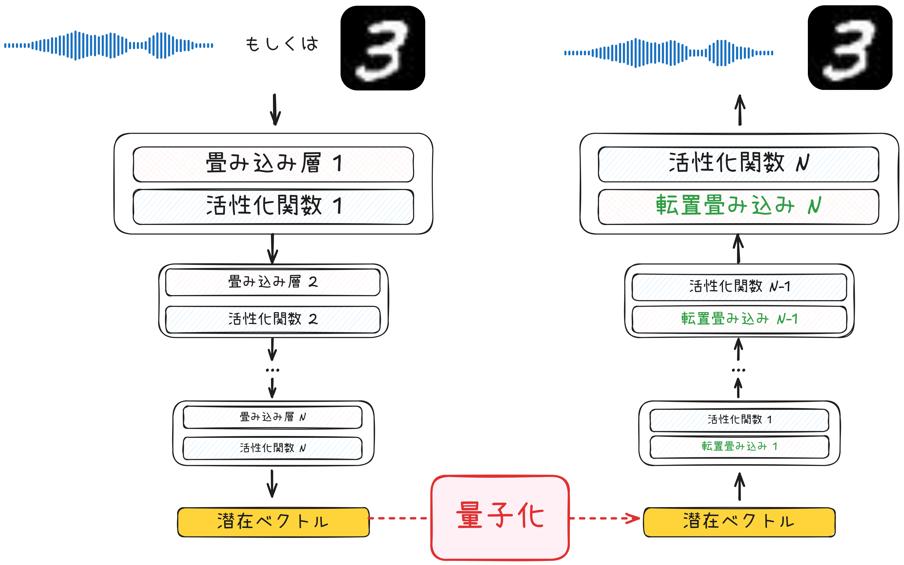

ずんだもん：これは由緒正しい、畳み込みニューラルネットワークの構造だね。

めたん：そう、ちなみに、今の最新鋭のモデルでも、この部分に関しての構造は大体昔からあったシンプルな構造を流用しているケースが多い。

つむぎ：コードに落とすとこんな感じです。

```python
class VQVAE(nn.Module):
    def __init__(self):
        super().__init__()
        # kernel = stride = 2 → 畳み込みの窓が重ならない
        # 2 層で縦横 1/4 になる（28 → 7）。潜在ベクトル 1 つ => 4×4 ピクセルのパッチ 1 つ
        self.enc = nn.Sequential(
            nn.Conv2d(in_channels=1, out_channels=32, kernel_size=2, stride=2),
            nn.GELU(),
            nn.Conv2d(in_channels=32, out_channels=DIM, kernel_size=2, stride=2)
        )

        # エンコーダと対称な構成（7 → 28 に戻す）
        self.dec = nn.Sequential(
            nn.ConvTranspose2d(in_channels=DIM, out_channels=32, kernel_size=2, stride=2),
            nn.GELU(),
            nn.ConvTranspose2d(in_channels=32, out_channels=1, kernel_size=2, stride=2),
            nn.Sigmoid()
        )
```


ずんだもん：ここは大昔のPyTorchの基本的な使い方な感じがして、懐かしいのだ


### Vector Quantize

つむぎ：そして、肝心なのがVQ（ベクトル量子化）の部分。エンコーダーが出した潜在ベクトルは、そのままデコーダーに渡すのではなく、いったん潜在空間の中でいちばん近い代表点に置き換えてから渡すんだ。

めたん：まずは、コードブックを定義します。いわば潜在空間から、どれだけの母点を取るのかを定義する。前のたとえを流用すれば、辞書のサイズを定義するということになります。

```python
class VectorQuantizer(nn.Module):
    def __init__(self, codebook_size: int, latent_dim: int):
        super().__init__()

        self.embbeding = nn.Embedding(codebook_size, latent_dim)
        nn.init.uniform_(self.embbeding.weight, -1, 1)

    def quantize(self, x):
        idx = torch.cdist(x, self.embbeding.weight).argmin(-1) # argminで勾配が消失しまうから
        z = self.embbeding.weight[idx]
        z_q = x + (z - x).detach()                              # Staight-Through 方式
        return z_q, idx
```

つむぎ：結構安直なコードだな

めたん：そう、とりあえず、コードブックを初期化関数の中で定義し、量子化関数で一番距離が小さいコードを求め、それの値とＩＤを戻すということだけな。適当に乱数的な値を入れると、こんな感じにはなります：

```python
vq =VectorQuantizer(8, 2)
rand = torch.rand((1,2))
```

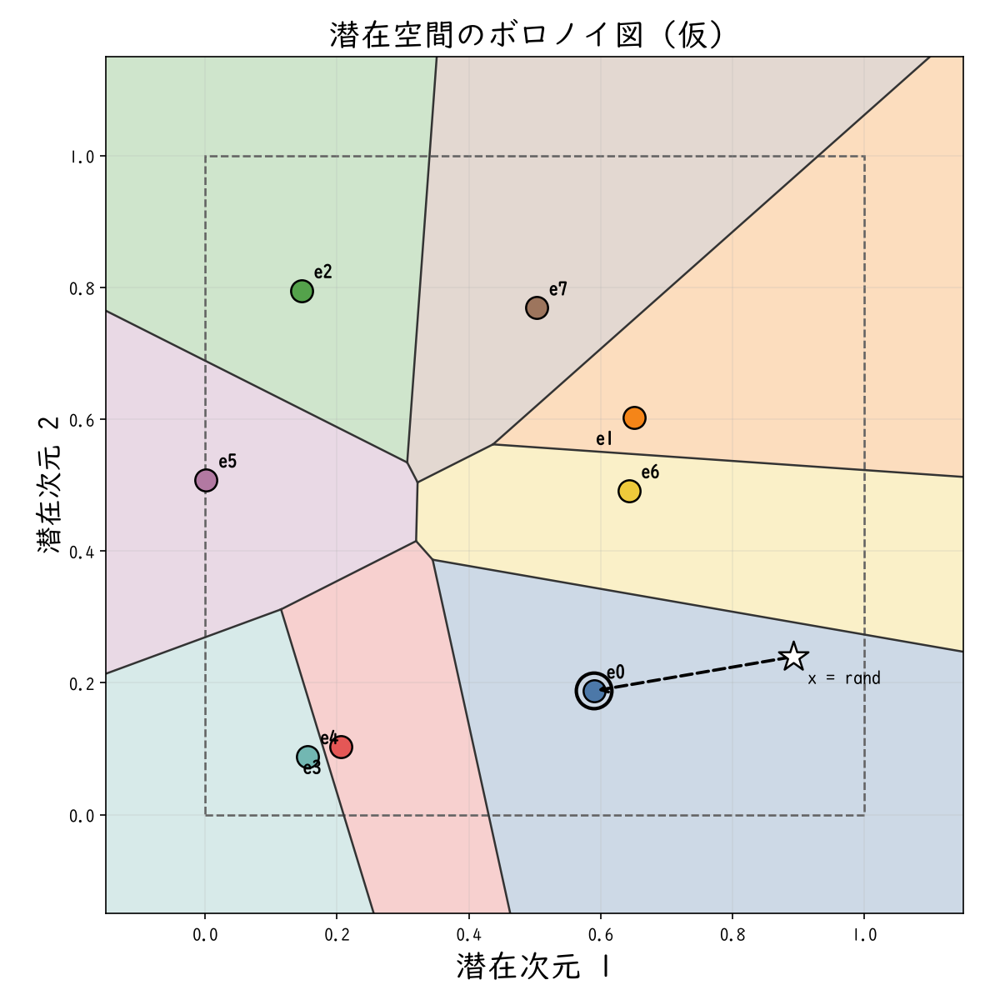

ずんだもん：あの変なのはなんのだ？detach?

つむぎ：あれは、「一番小さい値を探す」という操作は基本微分不可能だから、普通の場合、勾配がここで中断してしまうんだよ。

めたん：深層学習には、すべてのモデルが連鎖率によって一気に勾配を計算し、更新する必要があるので、もし勾配の計算が中断してしまったら、全体的には学習が不可能となります。

つむぎ：だから、この「最小値を探す」操作を無視して、無理やり勾配を複製するやり方がこちらのStraight-Through方式、勾配をそのまま通り抜ける方法ね。ここのdetach関数は、作用した部分を勾配計算から外すという意味で、要は、ここのxの勾配をz_qにそのままコピーするってことさ。って、数値的には、z_qはzと同じになる。


| 通り抜けえない | 通り抜く |
| :---: | :---: |
| 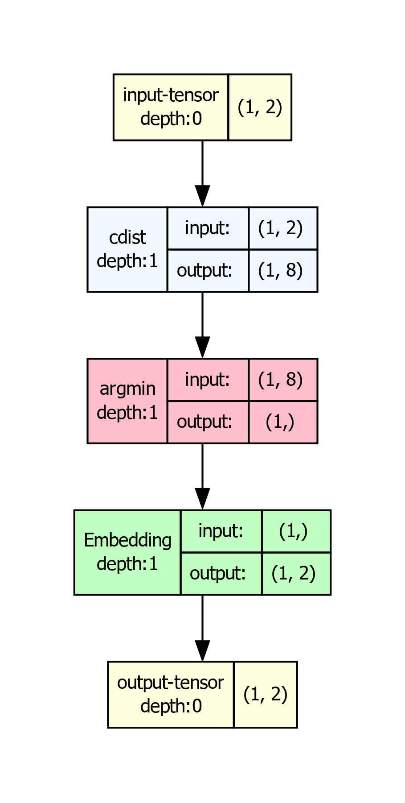| 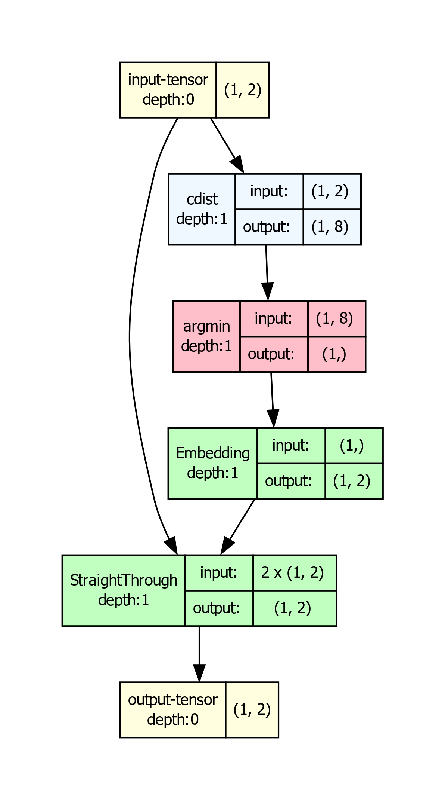|


### いったん組み立てる

めたん:それじゃ、いったんすべてのコードを組み立てて、流れを見よう。

```python
# DIM   : 潜在ベクトルの次元数
# CODES : コードブックのサイズ（コード数）
# BETA  : Commitment Loss の重み
DIM, CODES, BETA = 4, 64, 0.25

class VQVAE(nn.Module):
    def __init__(self, latent_dim):
        super().__init__()
        # kernel = stride = 2 → 畳み込みの窓が重ならない
        # 2 層で縦横 1/4 になる（28 → 7）。潜在ベクトル 1 つ => 4×4 ピクセルのパッチ 1 つ
        self.enc = nn.Sequential(
            nn.Conv2d(in_channels=1, out_channels=32, kernel_size=2, stride=2),
            nn.GELU(),
            nn.Conv2d(in_channels=32, out_channels = latent_dim, kernel_size=2, stride=2)
        )

        # エンコーダと対称な構成（7 → 28 に戻す）
        self.dec = nn.Sequential(
            nn.ConvTranspose2d(in_channels = latent_dim, out_channels=32, kernel_size=2, stride=2),
            nn.GELU(),
            nn.ConvTranspose2d(in_channels=32, out_channels=1, kernel_size=2, stride=2),
            nn.Sigmoid()
        )
        
        self.quantizer = VectorQuantizer(num_embeddings=CODES, embedding_dim=DIM)
        
    def encode(self, x):
        z_raw = self.enc(x)
        # チャネル（＝潜在次元）を最後に移し、位置ごとのベクトルをすべて一行に並べる
        z = z_raw.permute(0, 2, 3, 1).reshape(-1, DIM)
        z_q = self.quantizer(z)
        return z_q
    
    def decode(self, z_q):
        return self.decode(z_q)
    
    def forward(self, x):
        z_q = self.encode(x)
        # (B*7*7, DIM) → (B, DIM, 7, 7) に戻してデコーダへ
        z_q = z_q.view(len(x), 7, 7, DIM).permute(0, 3, 1, 2)
        return self.decode(z_q)   
```
めたん：こんな感じになります。

### コードブックの学習方法

つむぎ：これでエンコーダーとデコーダーは学習できるようになった。でも、まだ1つ抜けてるものがあるんだよね。

ずんだもん：……コードブックなのだ？

つむぎ：正解！ Straight-Throughの式を見直すと、quantizedは.detach()の中に入ってる。つまり、復元の誤差からはコードブックに勾配が1ミリも流れないの。

めたん：そこで、コードブック専用の損失を別に用意します。それが2つの損失です。

```python
# 第1項: コードブックをエンコーダ出力に近づける（エンコーダ側は固定）
# 第2項: エンコーダ出力をコードに近づける＝Commitment Loss（コードブック側は固定）
codebook_loss = F.mse_loss(q, z.detach())
commitment_loss = F.mse_loss(z, q.detach())
vq_loss = codebook_loss + BETA * commitment_loss
```

つむぎ：ボロノイ図で言えば、codebook_lossは母点を点の集まりの中心へ動かして、commitment_lossは点を母点の近くに留めておく。両側から歩み寄らせる感じだね。

めたん：betaは、エンコーダー側をどれだけ強く縛るかの重みです。元のVQ-VAEの論文では0.25が使われていて、ここでもそれに合わせています。代表点を動かすほうが主役で、エンコーダーへの縛りは控えめ、というバランスですね。

ずんだもん：ここのdetachとは？

めたん：qとzをそのまま計算すると、勾配は何になると覚えていますか？

ずんだもん：あ、っそうだ、ゼロになるのだ。

つむぎ：だから、連鎖率上で計算するのではなく；シンプルな定数として入れて計算するのよ。

#### 完成版

つむぎ：ここまでの部品を全部組み合わせると、こうなるよ。最後に、圧縮して送るときに必要な代表点の番号（indices）も返すようにしておこう。

```python
# DIM   : 潜在ベクトルの次元数
# CODES : コードブックのサイズ（コード数）
# BETA  : Commitment Loss の重み
DIM, CODES, BETA = 4, 64, 0.25

class VQVAE(nn.Module):
    def __init__(self):
        super().__init__()
        # kernel = stride = 2 → 畳み込みの窓が重ならない
        # 2 層で縦横 1/4 になる（28 → 7）。潜在ベクトル 1 つ => 4×4 ピクセルのパッチ 1 つ
        self.enc = nn.Sequential(
            nn.Conv2d(in_channels=1, out_channels=32, kernel_size=2, stride=2),
            nn.GELU(),
            nn.Conv2d(in_channels=32, out_channels=DIM, kernel_size=2, stride=2)
        )

        # エンコーダと対称な構成（7 → 28 に戻す）
        self.dec = nn.Sequential(
            nn.ConvTranspose2d(in_channels=DIM, out_channels=32, kernel_size=2, stride=2),
            nn.GELU(),
            nn.ConvTranspose2d(in_channels=32, out_channels=1, kernel_size=2, stride=2),
            nn.Sigmoid()
        )

        # コードブック：CODES 個の DIM 次元ベクトル
        self.codebook = nn.Embedding(CODES, DIM)
        nn.init.uniform_(self.codebook.weight, -1 / CODES, 1 / CODES)

    def encode(self, x):
        """
        x: (B, 1, 28, 28)
        戻り値: z   (B*7*7, DIM) 潜在ベクトル
                idx (B*7*7,)     各ベクトルに最も近いコード番号
        """
        z_raw = self.enc(x)  # (B, DIM, 7, 7)

        # チャネル（＝潜在次元）を最後に移し、位置ごとのベクトルをすべて一行に並べる
        z = z_raw.permute(0, 2, 3, 1).reshape(-1, DIM)
        
        # 全コードとのユークリッド距離を計算し、最も近いコードを選ぶ
        return z, torch.cdist(z, self.codebook.weight).argmin(1)

    def forward(self, x):
        z, idx = self.encode(x)
        q = self.codebook(idx)  # 量子化後のベクトル

        # 第1項: コードブックをエンコーダ出力に近づける（エンコーダ側は固定）
        # 第2項: エンコーダ出力をコードに近づける＝Commitment Loss（コードブック側は固定）
        codebook_loss = F.mse_loss(q, z.detach())
        commitment_loss = F.mse_loss(z, q.detach())
        vq_loss = codebook_loss + BETA * commitment_loss

        # Straight-Through 推定：順伝播では q を使い、逆伝播では勾配を z にそのまま流す（argmin は微分できないため）
        q = z + (q - z).detach()

        # (B*7*7, DIM) → (B, DIM, 7, 7) に戻してデコーダへ
        q = q.view(len(x), 7, 7, DIM).permute(0, 3, 1, 2)
        return self.dec(q), vq_loss
```
つむぎ：完璧！

### Residual Vector Quantizer（残差ベクトル量子化）
 
めたん：最後にもう一つ、残差ベクトル量子化（RVQ）を紹介します。VQでは代表点とのズレがどうしても残すので、音声ではそれが不自然さや本人らしくないとして聞こえてしまう。
 
ずんだもん：代表点をもっと増やせばいいのだ？
 
めたん：それは、潜在空間を万篇なく母点で塗りつくすと同じなので、現実的ではありません。そこで、残った誤差を別のコードブックでもう一度量子化し、これを繰り返して最後に全部足します。
 
つむぎ：数字でいうと、3.14159を「3」「0.1」「0.04」…と、大まかな値から順に直していく感じだね。
 
| 段 | 残差 | 量子化 | 合計 |
|:---:|---:|---:|---:|
| 1 | 3.14159 | 3 | 3 |
| 2 | 0.14159 | 0.1 | 3.1 |
| 3 | 0.04159 | 0.04 | 3.14 |
 
めたん：しかも、1024個のコードブックを8段重ねれば、代表点は8192個だけで 1024⁸ 通りを表せます。
 
ずんだもん：小さい辞書を何冊も組み合わせるのだ！
 
めたん：実装は、さっきの VectorQuantizer を段の数だけ並べるだけです。
 
```python
class ResidualVectorQuantizer(nn.Module):
    def __init__(self, num_quantizers: int, codebook_size: int, latent_dim: int):
        super().__init__()
        self.layers = nn.ModuleList(
            [VectorQuantizer(codebook_size, latent_dim) for _ in range(num_quantizers)]
        )
 
    def quantize(self, x):
        residual, z_q, indices = x, torch.zeros_like(x), []
        for vq in self.layers:
            q, idx = vq.quantize(residual)     # 各段で Straight-Through 込みの普通の VQ
            z_q = z_q + q
            residual = residual - q.detach()   # 表せなかった残りを次の段へ
            indices.append(idx)
        return z_q, torch.stack(indices, -1)
```
 
つむぎ：残りを次の段に渡してるだけ。使う段数を変えれば、音質と通信量のバランスも調整できるよ。
 
めたん：実際に聞いてみましょう。元の録音はこちら。
 
<audio controls src="assets/chap2_tokenizer/audio/codebooks_ablation/original.wav" title="Title"></audio>
 
| 使ったコードブック | 合成音声 |
|---:|---|
| 1個（cb0） | <audio controls src="assets/chap2_tokenizer/audio/codebooks_ablation/original_codec_k01.wav" title="Title"></audio> |
| 2個 | <audio controls src="assets/chap2_tokenizer/audio/codebooks_ablation/original_codec_k02.wav" title="Title"></audio> |
| 3個 | <audio controls src="assets/chap2_tokenizer/audio/codebooks_ablation/original_codec_k03.wav" title="Title"></audio> |
| 5個 | <audio controls src="assets/chap2_tokenizer/audio/codebooks_ablation/original_codec_k05.wav" title="Title"></audio> |
| 9個 | <audio controls src="assets/chap2_tokenizer/audio/codebooks_ablation/original_codec_k09.wav" title="Title"></audio> |
| 16個（すべて） | <audio controls src="assets/chap2_tokenizer/audio/codebooks_ablation/original_codec_k16.wav" title="Title"></audio> |
 
ずんだもん：増やすほど元の声に近づくのだ！ でも、cb0だけだとノイズみたいなのだ。
 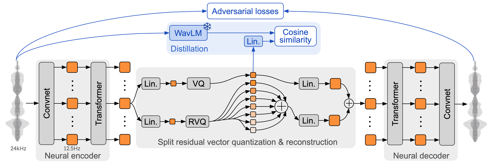

めたん：cb0だけは特別で、別のモデルから「何を話しているか」という意味の情報を蒸留して学習しています。話の中身やリズムは入っていても声色はほとんど入っていないので、それだけではノイズに聞こえるんです。声らしさを足すのはcb1以降の役目です。しかし、それ以外に、原理上の区別がなく、構造こそ複雑になったものの、基本の形は今日説明した簡単なVQVAEが同じです。

## まとめ
 
めたん：最後に、今回の内容を振り返りましょう。
 
- **Codec**：データを符号に変換し、符号から復元する仕組み。人間が気づきにくい情報を捨てて、データ量を減らす。
- **VQ-VAE**：エンコーダーでデータを潜在ベクトルに変換し、コードブックのいちばん近い代表点に置き換え（量子化）、デコーダーで復元する。データは「代表点の番号」の列として送れる。
- **学習の工夫**：argminは微分できないので、Straight-Throughで勾配を通す。コードブックはCodebook LossとCommitment Lossで学習する。
- **RVQ**：残った誤差を別のコードブックで繰り返し量子化して、精度を上げる。使う段数で、音質と通信量のバランスを調整できる。
 
Codecとは、データをよりコンパクトな符号に変換し、また符号から復元する仕組みです。復元したデータは、人間の感覚で大雑把だから、復元したデータが若干誤差が入るでもある程度許される。
音声や画像のCodecとして、VQ-VAEがよく使われて、データを潜在ベクトルに変換し、量子化することによって、データ量を劇的に減らすことができます。
しかし、普通の深層学習と違って、VQVAEの学習において、Staright Throughやコードブック用の余分のLossを用意する必要があります。
現代にて、より精度を追求するため、残差ベクトル量子化という、数段階の量子化手法がよく使われます。

参考文献
- https://zenn.dev/aratako_lm/articles/1214925e96bd58
- https://note.com/kikaben/n/nea10e7706656