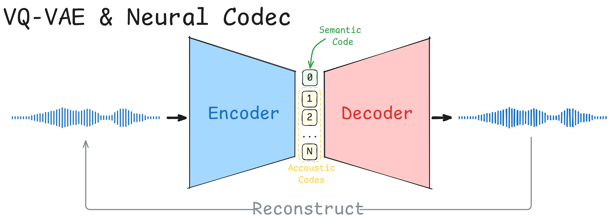
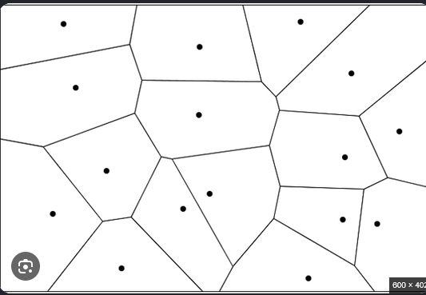

めたん：唐突ですが、「スマホから聞こえる相手の声は、実は本人の声そのものではない」って知ってました？

ずんだもん：どういうことなのだ？ 電話の向こうでしゃべってるのは本人なのだ。

つむぎ：たぶん、マイクに入った声をそのまま送ってるわけじゃない、ってことでしょ？ 通信量を減らすために、いったんデータを圧縮してから送ってるんだよね。

めたん：その通りです。圧縮すると、届く声は元の声と完全には一致しません。厳密に言えば「本人の声によく似た別の音」なんです。それでも私たちは、電話越しの声を本人の声として受け入れていますよね。人間の感覚は、細かすぎる違いを区別できないからです。色でも同じことが起きます。


めたん：この3つの黄色を見分けられる人は、ほとんどいません。だから、本来は連続的に変化する色を、近くにある限られた色のどれかで代用しても困らないんです。これを「量子化」と呼びます。昔の8bitカラーは、すべての色を256色のどれかに置き換えることで、データ量を抑えていました。


ずんだもん：つまり、電話の声も元の声とズレてるけど、人間には分からない程度ってことなのだ？

つむぎ：電話は回線によっては「声がこもってるな」って分かることもあるけどね。音楽ならもっと分かりやすい例があるよ。MP3とFLACの違いを聞き分けられる人って、ほとんどいないでしょ？


めたん：まさにそれです。音楽配信サービスにある「ロスレス」というオプションは、入力した音声ファイルと再生されるファイルのあいだに誤差がないことを保証するものです。でも裏を返せば、MP3のように多少情報を捨てても、人間はほとんど気づかない。この性質を極限まで突き詰めて、情報を大胆に圧縮するのが「Neural Codec」です。

----

めたん：Neural Codecは、深層学習を使ったCodecです。従来の手法とは圧縮性能が桁違いなんです。実際に聞き比べてみましょう。まずは原音から。

<audio controls src="../src/chap3/EMOTION100_001.wav" title="Title"></audio>

めたん：次に、ネット通話でよく使われる従来型のCodec「Opus」を、Neural Codecの一つであるMimiと同じくらいのビットレート（約1kbps）まで落とすと、こうなります。

<audio controls src="../src/chap3/opus_results/EMOTION100_001_1k_decoded.wav" title="Title"></audio>

ずんだもん：うわ、ガビガビで何を言ってるのか分からないのだ！

めたん：では、同じくらいのビットレートでMimiを使うと……

<!-- TODO: Mimiで圧縮・復元した音声のパスを入れる -->
<audio controls src="（Mimiの復元音声）" title="Title"></audio>

ずんだもん：ほとんど元の声と同じなのだ！ どうやってるのだ？



つむぎ：イメージとしては、ペアになった2つのモデルを用意する感じかな。1つ（エンコーダー）が音声を短い符号に変換して、もう1つ（デコーダー）が符号から音声を復元する。

めたん：その通りです。この構造はVQ-VAEとして知られています。日本語にすると「ベクトル量子化を使った変分オートエンコーダー」です。

つむぎ：VQ-VAEって、もともと画像生成でよく使われてたやつだよね。

めたん：ええ。考え方は、さっきの色の量子化と同じです。まず、エンコーダーで画像を「潜在空間」というベクトルの空間に写します。次に、その空間の中に代表点（コードブック）をいくつか用意して、各ベクトルをいちばん近い代表点に置き換えます。最後に、デコーダーが代表点から画像を復元します。このとき潜在空間は、「どの代表点にいちばん近いか」によって分割され、ボロノイ図のような形になるんです。



ずんだもん：なるほど、四捨五入みたいなものなのだ。少し情報を捨ててもだいたい復元できる空間を作って、その中に代表点を置いて、周りの点をぜんぶ代表点に寄せる。そうすれば、代表点の番号だけ送ればいいのだ！ でも、具体的にはどう作るのだ？

---

つむぎ：画像の例で説明するね。音声もデータの次元が違うだけで、仕組みはほぼ同じだから。まずはエンコーダーとデコーダーから始めよう。基本的に、このような構造が考えられる

```python
class Encoder(nn.Module):
    def __init__(self, embedding_dim=16):
        super().__init__()

        self.layers = nn.Sequential(
            # [B, 1, 28, 28] -> [B, 32, 14, 14]
            nn.Conv2d(1, 32, kernel_size=4, stride=2, padding=1),
            nn.GELU(),

            # [B, 32, 14, 14] -> [B, embedding_dim, 7, 7]
            nn.Conv2d(32, embedding_dim, kernel_size=4, stride=2, padding=1),
        )

    def forward(self, x):
        return self.layers(x)


class Decoder(nn.Module):
    def __init__(self, embedding_dim=16):
        super().__init__()

        self.layers = nn.Sequential(
            # [B, embedding_dim, 7, 7] -> [B, 32, 14, 14]
            nn.ConvTranspose2d(
                embedding_dim, 32, kernel_size=4, stride=2, padding=1
            ),
            nn.GELU(),

            # [B, 32, 14, 14] -> [B, 1, 28, 28]
            nn.ConvTranspose2d(32, 1, kernel_size=4, stride=2, padding=1),
            nn.Sigmoid(),
        )

    def forward(self, z):
        return self.layers(z)
```

つむぎ：エンコーダーは28×28の画像を、7×7個の16次元ベクトルに縮める。デコーダーはその逆をやる。左右対称の、シンプルな畳み込みネットワークで十分だよ。音声なら、2次元の画像の代わりに1次元の波形を扱うだけ。

ずんだもん：これは後で新たな層を追加したり、中身を変えたりするのも簡単どうだな。

つむぎ：そうです。ちなみに、エンコーダーとデコーダーは必ずしも対称的に作られる必要がなく、デコーダーに強力なつくりにしているデザインも多い。そして、肝心なのがVQ（ベクトル量子化）の部分。

```python
class VectorQuantizer(nn.Module):
    def __init__(self, num_embeddings=64, embedding_dim=16, beta=0.25):
        super().__init__()

        self.beta = beta
        self.codebook = nn.Embedding(num_embeddings, embedding_dim)

        nn.init.uniform_(
            self.codebook.weight,
            -1 / num_embeddings,
            1 / num_embeddings,
        )

    def forward(self, z):
        # Move channels last: [B, D, H, W] -> [B, H, W, D]
        z = z.permute(0, 2, 3, 1).contiguous()
        flat_z = z.reshape(-1, z.shape[-1])

        # Compute squared distances to all codebook vectors.
        distances = (
            flat_z.square().sum(dim=1, keepdim=True)
            + self.codebook.weight.square().sum(dim=1)
            - 2 * flat_z @ self.codebook.weight.T
        )

        # Choose the nearest codebook vector for each position.
        indices = distances.argmin(dim=1)
        quantized = self.codebook(indices).view_as(z)

        # Train the codebook and encourage encoder commitment.
        codebook_loss = F.mse_loss(quantized, z.detach())
        commitment_loss = F.mse_loss(z, quantized.detach())
        vq_loss = codebook_loss + self.beta * commitment_loss

        # Straight-through estimator: pass gradients from quantized to z.
        quantized = z + (quantized - z).detach()

        # Restore shape: [B, H, W, D] -> [B, D, H, W]
        quantized = quantized.permute(0, 3, 1, 2).contiguous()

        return quantized, vq_loss
```

ずんだもん：コードは分かったけど、中で何をしてるのか教えてほしいのだ。

つむぎ：ポイントは3つ。1つ目は、エンコーダーが出したベクトルとコードブックの全ベクトルとの距離を計算して、いちばん近いものを選ぶこと（argmin）。これが、さっきのボロノイ図で「どの領域に入るか」を決める処理だね。

つむぎ：2つ目は損失。codebook_lossでコードブックをエンコーダーの出力に近づけて、commitment_lossでエンコーダーの出力がコードブックから離れすぎないようにする。両側から歩み寄らせる感じ。

つむぎ：3つ目がStraight-Through推定。「いちばん近いものを選ぶ」操作は微分できないから、そのままだとエンコーダーまで勾配が届かない。そこで、順伝播では量子化後の値を使って、逆伝播では量子化をなかったことにして、勾配をそのまま素通りさせるの。

ずんだもん：なるほど、選ぶところだけ見なかったことにして学習を通すのだ。

つむぎ：実際に学習を回すと、こんなふうに画像を復元できて、潜在空間もきれいに分割されるよ。

<!-- TODO: 復元画像と潜在空間の可視化を挿入 -->

めたん：ただ、音声は画像よりずっと細かい情報が必要なので、VQを1段だけ使うと、代表点が粗すぎて音質が足りません。そこで音声では、RVQ（残差ベクトル量子化）がよく使われます。まず1段目のVQで大まかに量子化し、元のベクトルとのズレ（残差）を2段目のVQで量子化する。さらにその残差を3段目で……と重ねていくんです。

ずんだもん：四捨五入したあとの端数を、また四捨五入していく感じなのだ？

めたん：その通りです。段数を増やすほど潜在空間の中の細かい位置まで表せるので、音質は上がりますが、その分ビットレートも増えます。段数で、音質とデータ量のバランスを調整できるわけですね。Mimiもこの仕組みで、約1.1kbpsという低いビットレートを実現しています。

つむぎ：じゃあ最初の話に戻ると、Neural Codecで届く声って……

めたん：受け取った番号をもとに、デコーダーが「それらしい声」を新しく作り直したもの、ということになります。

ずんだもん：やっぱり本人の声じゃなかったのだ！ でも、聞き分けられないなら本人の声と同じ……なのか？


参考文献
- https://zenn.dev/aratako_lm/articles/1214925e96bd58