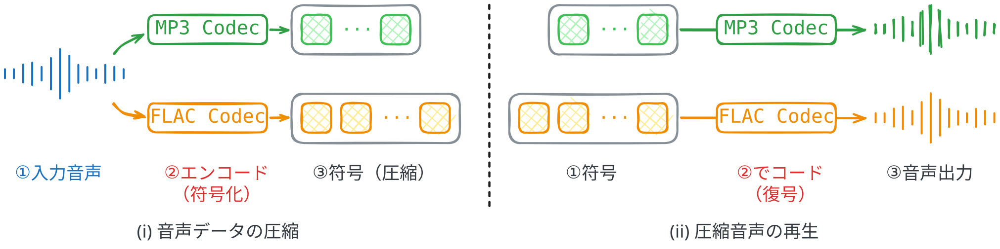
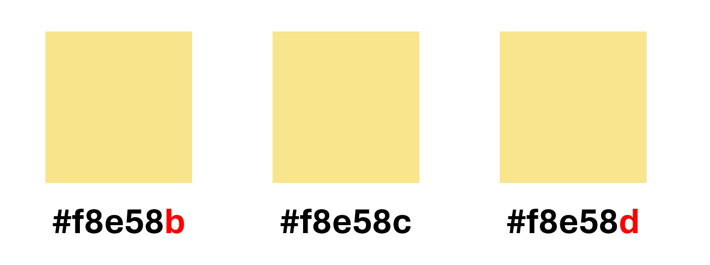
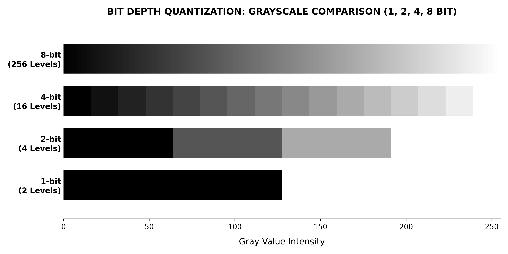

# 『スマホから聞こえる声は、実は本人の声ではない』


自然界の音は、モノの振動によって生じる波です。その振動が空気を通じて耳に伝わり、脳がそれを歌なりセリフなりとして認識します。
この振動のパターンを記録し、再生することで、我々は同じ音楽を繰り返し聴くことができます。
また、振動のパターンを上司や指導教員に送れば、休暇中にもかかわらずZOOM会議をすることもできます。

では、「振動を記録する」とはどういうことでしょうか。
一番わかりやすいのは、レコードのような、「振動」そのものを媒体に刻み込む方法です。
レコードの表面にはらせん状の溝があり、その溝には、録音された音の振動に応じた細かな凸凹が刻まれています。
この溝に沿ってレコード針が動くと、凸凹に応じて針が振動します。
その振動を電気信号に変え、増幅してスピーカーで再生すると、元の音が聞こえるわけです。


しかし、デジタル媒体では、同じ方法は使えません。
メモリーには、物理的な溝を刻み込むと壊れてしまうからです。
だから、振動のパターンを数値として保存する必要があります。
そこで、波の振幅を一定の（きわめて短い）時間間隔で測定します。
これが「サンプリング」です。測定した値を数値として保存し、それをもとに波を再現することで、元の音に近い音を再生できます。

例えば、1秒間に数万回、波の振幅を測定して記録します。
その記録をもとに、同じ時間間隔で振幅が変化するように波を再現すると、元の音に極めて近い音を再生できるというわけです。


## 音はリストである

音声ファイルを読み込むと、**波の振幅を記録したリスト**と**サンプリングレート**を確認できます。

<!--  -->


音声データをグラフにすると、全体として波のような形になります。
これは物理的な振動を表しているためで、音の高さや強さによって形が変わります。

この波形を拡大すると、一つひとつの点で構成されていることがわかります。それぞれの点を「**サンプル**」と呼び、1秒間あたりのサンプル数を「**サンプリングレート**」と呼びます。

再生時に使うサンプリングレートが録音時のそれより高い場合、通常より早く再生することができます。逆に、録音時のサンプリングレートより低い値のサンプリングレートで再生すると、音声データをスロー再生することができます。
この方法では、再生速度とともに音の高さも変わりますので、早送りするときの音が高くなるとスロー再生するときに低くなるのは、これが原因です。

## 音は難しい

音声を取り扱うのは、文字よりはるかに難しいです。
<!-- Morning.mp3 にします -->
例えば、サンプリングレートが44.1 kHzの1分間の音声には、1チャンネルあたり、次の数のサンプルが含まれています。
```
44.1 × 1,000 × 60 = 2,646,000個
```

文字数と比べてみると、ライトノベル1冊を約10万文字とすると、サンプルの数だけで約26冊分の文字数に相当します。
もしそのまま生成モデル使って、サンプルごとに生成すると、一分間の音声を生成する難易度が、一気に26冊分の小説と匹敵することになります。
もちろん、1サンプルと1文字では含まれる情報が異なるため、データ量をそのまま比較できるわけではありません。
それでも、扱う要素の数が非常に多いことはわかります。

そのため、音声を効率よく処理し、さらに高品質の音声を生成するためには、入力として扱うデータの量を減らすことが重要になります。では、どうすれば減らせるのでしょうか。そこには、さまざまな工夫が必要です。

## Neural Audio Codec

今のご時世、何ものであれ、とりあえず「Neural」が付いたら、やたら高級感を感じませんか？
こと「Neural Audio Codec」に関して、特に普通のCodecから一層神秘的とは思いませんか？
例えば、最近話題になっていた「MIMI」というCodecがありました、それって普通のCodecと何が違うのか？
そもそもCodecとは何？のような質問を、本節で軽く紹介したいと思います。

### そもそもCodecとはなに



コーデック（Codec）とは、音声や動画などのデータを、圧縮したり復元したりするプログラムです。
なぜ音声や動画を圧縮するかというと、この手のデータが重いからです。
例えば、「MP3」や「WAV」のようなフォマードが音声の界隈があって、多分皆さんがD〇SITEから音声の作品を購入する際には、よく見かけているだと思います。
「WAV」が元々の音質をそのまま反映するに対して、「MP3」の音質がやや劣るが（正直大差ありません）、ファイルの軽量化ができます。
<!-- MPEG-1 Audio Layer I -->
そこで、「MP3」専用のCodecが使われて、原音（WAVのようなファイル、もしくはマイクからの入力）をより省スペースのMP3ファイルに変換します。それが、最初にCodecが使われた理由です。ちなみに、MP3のCodecは「MPEG-1 Audio Layer III」と言います（豆知識）。

### Neural Audio Codecとは何？普通のCodecとは何か違うの？
Neural Audio Codecは生成モデルのために設計されたCodecです。もちろん、その機能は音を圧縮にあります。
しかし、ただ圧縮することは普通のCodecもできるし、なぜわざわざ新しいCodecを設計する必要がありますかというと、普通のCodec、例えばMP3など、圧縮こそできると、トークンとして圧縮してはいません。かつ音声を生成するモデルにおいて、一つ重要な要素として、声が若干違うとも（例えば萌え声を指定したが、でもあんまり萌えを感じないとしても）、ハキハキ話していって、聞き取りやすい声が望ましいです。それは普通のCodecが満足できないところなんです。もう一つ最重要の要素として、Neural　Codecは普通のCodecよりだいぶ圧縮能力が強いです。

例えば、「Opus」という、ネット配信によく使われるCodecがあります。それをNeural CodecのMIMIと同じ圧縮率に落とすと、こうなります

<audio controls src="../src/chap3/opus_results/EMOTION100_001_1k_decoded.wav" title="Title"></audio>

ちなみに、原音はこちら

<audio controls src="../src/chap3/EMOTION100_001.wav" title="Title"></audio>

それでは、Neural Codecの実力も聞きましょう。使ったのはQwen3TTSのNeural Codecです。

中々よかったよね。

### Neural Codecの作り方

いよいよ、Neural Codecの話になります。Neural　Codecそのもの、一つのVQVAEと認識しても構いません。VAEとは、元々情報をニューラルネットワークを使って、圧縮するためのツールです。その仕組みは極めてシンプルで、皆さん、砂時計の形を思い出してほしいです。砂時計の両端は太く、真ん中は細いように設計されているの用に、もし一つのネットワークの入力と出力が同じく、でも真ん中のどこかが入力の部分より情報量が少ないとしたら、そのネットワークを半分にして、入力、潜在空間、出力に分解することで、潜在空間が入力の圧縮された形態となります。

この世で一番簡単なVAEは以下のように

```python
import torch
from torch import nn

class 簡単VAE(nn.Module):
    def __init__(self, in_channels, latent_space):
        super().__init__()
        
        self.encoder = nn.Linear(in_channels, latent_space)
        self.decoder = nn.Linear(latent_space, in_channels)  # 入力と逆
        
    def forward(self, x):
        latent = self.encoder(x)
        print("-> 潜在空間：", latent.shape)
        y = self.decoder(latent)
        return y
    
model = 簡単VAE(16, 8)
rand_input = torch.rand((16))

print("-> 入力　　：", rand_input.shape)
out = model(rand_input)
print("-> 出力　　：", out.shape)
```
その出力はもちろん

```sh
-> 入力　　： torch.Size([16])
-> 潜在空間： torch.Size([8])
-> 出力　　： torch.Size([16])
```
至極簡単なことです。

しかし、こういったネットワークが連続的な空間に依存します。ここの連続というのは、潜在空間はフロート数により構成され、フロート数の数ほど、潜在空間の状態があります。英語の資料では、それを「連続」と説明したものが多いが、イメージ的には、「密度が高い」というのは自分の中のイメージです。

その密度の高い潜在状態を表すために、必要なトークンのデータ量もその密度に応じて多くなります。一つ簡単な例で例えると、二進法でN通りのパターンを表すと、logNのデータ量が必要とされる。音の圧縮効果がそのデータ量に応じて、弱くなります。

それでは、どうやってさらに圧縮するのか？答えは、離散かです。考え方は至極簡単です。潜在空間から、いくつかの点を選び、その点の近傍の状態をすべてその点で表すことです。画像処理において、これは「色の量子化」と言い、昔から使われた手法です。画像の色空間も、同じく緻密な連続空間になります。例えば、このような黄色たちがあります




どれも違う黄色となり、しかしどれも見た目は同じとなります。実務上、この三つを全部同じ黄色にすることができる。それが色の量子化です。16bit の空間（16ビット機ではない）で、人の目には十分するほど、あたかも色彩空間が連続しているような色を表現できます。



こういった手法を使えば、緻密な空間が一気に有限個の点に落とし込むことができます。

それがVQVAEの主な手法です。連続な値を途中で離散かすることで、似たような声の状態を一つの代表的な状態で代用します。

それでは、代用することは簡単です。一番近いコードを探せばいいです。しかし、その代表的なコードはどう選ばれるのかは肝心です。


参考文献
- https://spark-journal.kddi.com/tsunagu/ts1458/