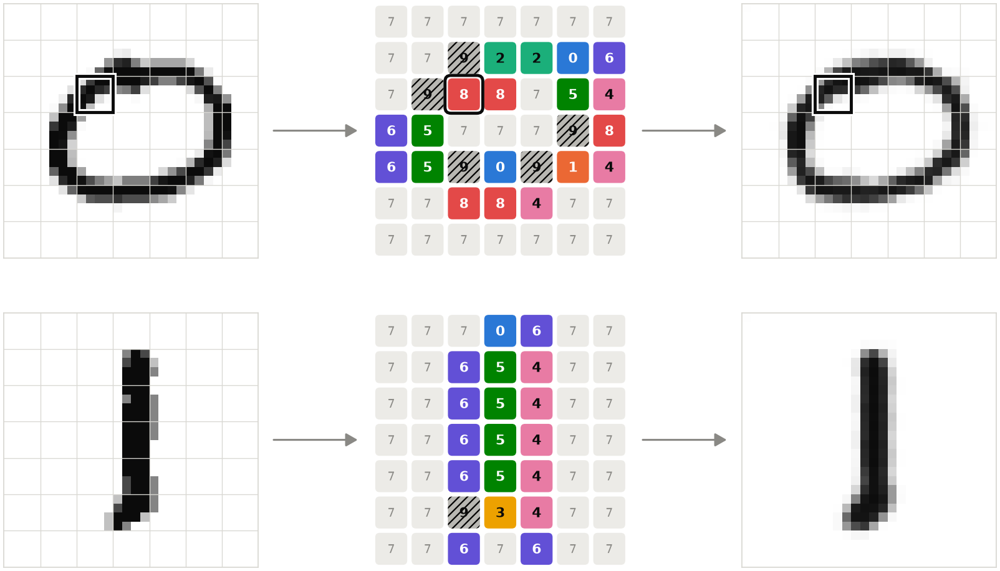
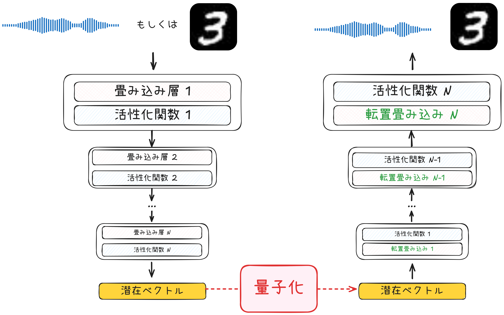
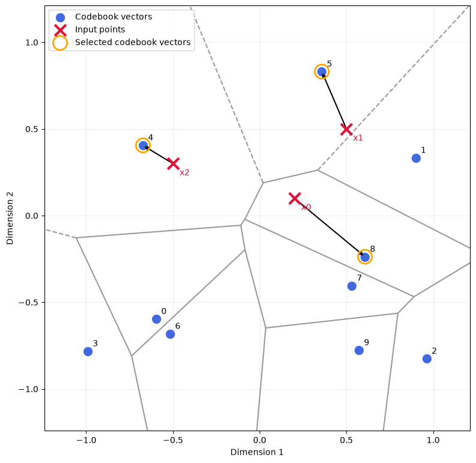
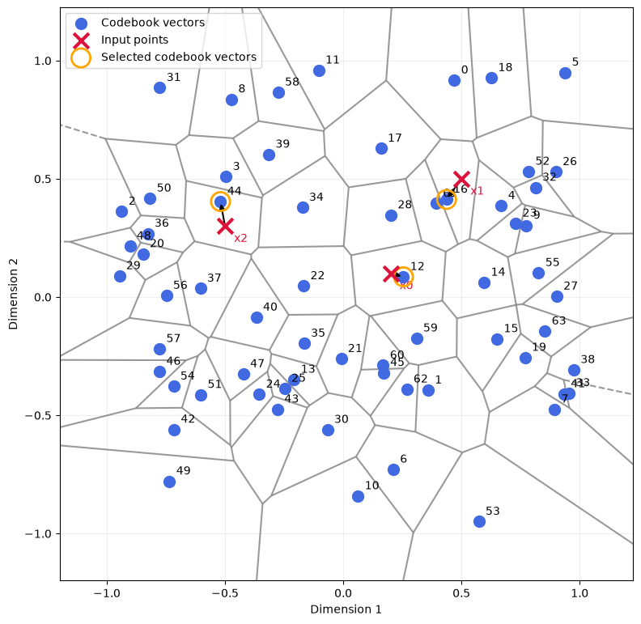

## 「スマホから聞こえる相手の声は、実は本人の声そのものではない」
めたん：突然ですが、「スマホから聞こえる相手の声は、本人の声そのものではない」って知ってた？
 
ずんだもん：どういうことなのだ？ しゃべってるのは本人なのだ。
 
つむぎ：糸電話じゃないから、マイクに入った声を、そのまま送ってるわけじゃないってことでしょ？ 通信量を減らすために圧縮してるんだよね。
 

 
めたん：その通りです。声は符号に変換されて送られ、受け取った側でその符号から声を復元します。だから届くのは「符号から復元した声」で、厳密には「本人によく似た他人の声」なんです。
 
つむぎ：電話の声って音質が悪いもんね。圧縮で情報が削られてるからなんだ。
 
ずんだもん：でも、「本人じゃない！」って思ったことはないのだ。
 
めたん：そこが面白いところです。多少音質が落ちても、私たちは本人の声として受け入れます。音楽ならなおさらで、MP3とFLACを聞き分けられる人はほとんどいません。
 

 
ずんだもん：FLACって、配信サービスの「ロスレス」のことなのだ？ 確かに違いはよく分からないのだ。
 
めたん：ええ。FLACも符号化はしますが、元の音を誤差なく復元できます。一方MP3は、人間に聞こえにくい情報を捨ててファイルを小さくしています。それでも、ほとんどの人は気づきません。
 
つむぎ：人間の感覚って、意外と大ざっぱなんだね。
 
めたん：目も同じです。この3つの黄色、見分けられますか？
 

 
めたん：だから、連続的な色を限られた色のどれかで代用しても困りません。これを「量子化」と呼びます。昔の8bitカラーは、すべての色を256色に置き換えてデータ量を抑えていました。
 

 
つむぎ：音声も同じといいたいよね。多少の誤差なら、人間の耳はほとんど気づかないっと。
 
めたん：その通りです。この性質を利用して、情報量を大胆に削ったのが「Neural Codec」です。
 
----
## Neural Codec

### Intro

ずんだもん：そもそもCodecってなんなの？

つむぎ：Codecとは、データを符号に変換したり、符号からデータを復元するための装置よ。例えば前に出てきた「MP3」や「FLAC」は音楽においての有名Codecで、画像において「Jpeg」なども有名です。


めたん：Neural Codecは、深層学習を使ったCodecです。従来の手法とは圧縮性能が桁違いなんです。実際に聞き比べてみましょう。まずは原音から。

<audio controls src="../src/chap3/EMOTION100_001.wav" title="Title"></audio>

めたん：次に、ネット通話でよく使われる従来型のCodec「Opus」を、Neural Codecの一つであるMimiと同じくらいのビットレート（約1kbps）まで落とすと、こうなります。

<audio controls src="../src/chap3/opus_results/EMOTION100_001_1k_decoded.wav" title="Title"></audio>

ずんだもん：うわ、ガビガビで何を言ってるのか分からないのだ！

めたん：では、同じくらいのビットレートでMimiを使うと……

<!-- TODO: Mimiで圧縮・復元した音声のパスを入れる -->
<audio controls src="（Mimiの復元音声）" title="Title"></audio>

ずんだもん：ほとんど元の声と同じなのだ！ どうやってるのだ？


つむぎ：イメージとしては、ペアになった2つのモデルを用意する感じかな。1つ（エンコーダー）が音声を短い符号に変換して、もう1つ（デコーダー）が符号から音声を復元する。間には、量子化もはさんで、トークンを離散化するって感じかな

めたん：その通りです。この構造はVQ-VAEとして知られています。
<!-- 日本語にすると「ベクトル量子化を使った変分オートエンコーダー」です。 -->

つむぎ：VQ-VAEって、もともと画像生成でよく使われてたやつだよね。



めたん：ええ。まず、エンコーダーで画像を「潜在空間」というベクトルの空間に写します。次に、その空間の中に代表点（コードブック）をいくつか用意して、各ベクトルをいちばん近い代表点に置き換えます。最後に、デコーダーが代表点から画像を復元します。このとき潜在空間は、「どの代表点にいちばん近いか」によって分割され、ボロノイ図のような形になるんです。このすべてが自動的に学習することができ、人為的に代表点を選定する必要がありません。


ずんだもん：なるほど、四捨五入みたいなものなのだ。少し情報を捨ててもだいたい復元できる空間を作って、その中に代表点を置いて、周りの点をぜんぶ代表点に寄せる。そうすれば、代表点の番号だけ送ればいいのだ！ でも、具体的にはどう作るのだ？

## VQVAE

### Encoder & Decoder
つむぎ：画像の例で説明するね。音声もデータの次元が違うだけで、仕組みはほぼ同じだから。まずはエンコーダーとデコーダーから始めよう。基本的に、このような構造が考えられる



ずんだもん：これは由緒正しい、畳み込みニューラルネットワークの構造だね。

めたん：そう、ちなみに、この構造の中に、いろいろカスタマイズして、トランスフォーマーなどを入れる試みがたくさんあります。

つむぎ：コードに落とすとこんな感じです。

```python
class Encoder(nn.Module):
    def __init__(self, embedding_dim=16):
        super().__init__()

        self.layers = nn.Sequential(
            # [B, 1, 28, 28] -> [B, 32, 14, 14]
            nn.Conv2d(1, 32, kernel_size=4, stride=2, padding=1),
            nn.GELU(),

            # [B, 32, 14, 14] -> [B, embedding_dim, 7, 7]
            nn.Conv2d(32, embedding_dim, kernel_size=4, stride=2, padding=1),
        )

    def forward(self, x):
        return self.layers(x)


class Decoder(nn.Module):
    def __init__(self, embedding_dim=16):
        super().__init__()

        self.layers = nn.Sequential(
            # [B, embedding_dim, 7, 7] -> [B, 32, 14, 14]
            nn.ConvTranspose2d(
                embedding_dim, 32, kernel_size=4, stride=2, padding=1
            ),
            nn.GELU(),

            # [B, 32, 14, 14] -> [B, 1, 28, 28]
            nn.ConvTranspose2d(32, 1, kernel_size=4, stride=2, padding=1),
            nn.Sigmoid(),
        )

    def forward(self, z):
        return self.layers(z)
```

つむぎ：今はMNIST画像の場合を考えている。エンコーダーは28×28の画像を、7×7個の16次元ベクトルに縮める。デコーダーはその逆をやる。左右対称の、シンプルな畳み込みネットワークで十分だよ。音声なら、2次元の画像の代わりに1次元の波形を扱うだけ。

ずんだもん：これは後で新たな層を追加したり、中身を変えたりするのも簡単そうだな。

### Vector Quantize

つむぎ：そして、肝心なのがVQ（ベクトル量子化）の部分。エンコーダーが出した潜在ベクトルは、そのままデコーダーに渡すのではなく、いったん潜在空間の中でいちばん近い代表点に置き換えてから渡すんだ。

めたん：まずは、コードブックを定義します。いわば潜在空間から、どれだけの母点を取るのかを定義する。前のたとえを流用すれば、辞書のサイズを定義するということになります。

```python
class VectorQuantizer(nn.Module):
    def __init__(self, num_embeddings=64, embedding_dim=16, beta=0.25):
        super().__init__()

        self.beta = beta  # 後で使うハイパーパラメータ
        self.codebook = nn.Embedding(num_embeddings, embedding_dim)  # 辞書のオブジェクト、num_embeddings 個の embedding_dim サイズのベクトルによって構成したテーブル

        nn.init.uniform_(self.codebook.weight, -1 / num_embeddings, 1 / num_embeddings,)  # 辞書を初期化する
```

このコードを試すと

```python
vq = VectorQuantizer(num_embeddings=2, embedding_dim=8)
print("辞書の中身：")
print(vq.codebook.weight)
print("\n要素を取り出してみよう:")
print(vq.codebook.weight[0])
```
こんな結果となります

```bash
辞書の中身：
Parameter containing:
tensor([[ 0.3854,  0.0739, -0.2334,  0.1274, -0.2304, -0.0586, -0.2031,  0.3317],
        [-0.3947, -0.2305, -0.1412, -0.3006,  0.0472, -0.4938,  0.4516, -0.4247]],
       requires_grad=True)

要素を取り出してみよう:
tensor([ 0.3854,  0.0739, -0.2334,  0.1274, -0.2304, -0.0586, -0.2031,  0.3317],
       grad_fn=<SelectBackward0>)
```

ずんだもん：要はベクトルのリストをとりあえず定義することだな

めたん：その通り。ここに「いちばん近い代表点を探す」機能を追加します。

```python

class VectorQuantizer(nn.Module):
    def __init__(self, num_embeddings=64, embedding_dim=16, beta=0.25):
        super().__init__()
        self.beta = beta
        self.codebook = nn.Embedding(num_embeddings, embedding_dim)
        nn.init.uniform_(self.codebook.weight, -1, 1)

    def forward(self, x):
        # x: [B, D]
        # codebook: [N, D]
        # squared_distances: [B, N]
        squared_distances = (
            self.codebook.weight.unsqueeze(0) - x.unsqueeze(1)
        ).square().sum(dim=-1)

        indices = squared_distances.argmin(dim=1)
        return self.codebook(indices), indices
```
めたん：ここではBroadcastというテクニックを使って、入力ベクトルとコードブックの全ベクトルとの（二乗）ユークリッド距離を一度に計算しています。[B, 1, D]と[1, N, D]の差を取ると、自動的に[B, N, D]に引き伸ばされるんです。なお、図で見やすくするために、ここでは初期化の範囲を-1〜1に広げています。
同じく試してみると

```python
vq = VectorQuantizer(num_embeddings=10, embedding_dim=2)

print("辞書の中身：")
print(vq.codebook.weight)

print("\n一番近いやつを探す:")
x = torch.tensor([
    [0.2, 0.1],
    [0.5, 0.5],
    [-0.5, 0.3]
])

quantized, indices = vq(x)
print(quantized)
```
こんな感じになります

```bash
辞書の中身：
Parameter containing:
tensor([[-0.5964, -0.5964],
        [ 0.8994,  0.3333],
        [ 0.9623, -0.8253],
        [-0.9919, -0.7824],
        [-0.6727,  0.4050],
        [ 0.3581,  0.8309],
        [-0.5164, -0.6817],
        [ 0.5306, -0.4042],
        [ 0.6069, -0.2373],
        [ 0.5720, -0.7770]], requires_grad=True)

一番近いやつを探す:
tensor([[ 0.6069, -0.2373],
        [ 0.3581,  0.8309],
        [-0.6727,  0.4050]])
```
ちなみに、前に説明したボロノイ図の視点から見ると、こんな感じになります。

格子の内部の空間のすべての点が、選択された母点に収束しに行くイメージです。母点をより多く設置すると、この近似の精度ももちろん上がります



ずんだもん：これで「いちばん近い代表点に置き換える」はできたのだ！ もう完成なのだ？

つむぎ：実はまだ3つ問題が残ってるんだよね。1つ目は計算の重さ、2つ目がいちばん大事な「学習できない」問題。順番に片づけていこう。


#### その1：距離の計算を軽くする

つむぎ：次は計算の重さ。さっきのBroadcastは分かりやすいけど、[ベクトルの数, N, D]っていう巨大な中間テンソルを作っちゃうんだよね。

めたん：具体的に計算してみましょう。バッチ64枚、7×7マス、コードブック512個、ベクトル64次元だとすると、中間テンソルは 64×49×512×64 ≒ 1億個の数値で、約411MBになります。音声は画像よりずっと長いので、すぐにメモリが足りなくなります。

ずんだもん：距離を求めるだけで411MBはもったいないのだ。

つむぎ：そこで、中学校で習った展開公式を使うの。

$$
\|a - b\|^2 = \|a\|^2 + \|b\|^2 - 2\, a \cdot b
$$

つむぎ：右辺の3つの項は、どれもD次元を足し終えた後の値だから、[ベクトルの数, N]の大きさで済む。特に最後の内積は行列の掛け算（@）1回で全部まとめて計算できるから、GPUが得意な計算になるんだ。

めたん：同じ例だと、必要なのは 64×49×512 個、約6.4MBです。64分の1ですね。

ずんだもん：本当に同じ答えになるのだ？

つむぎ：小さい例で確かめてみよう。

```python
x = torch.tensor([[1., 2.]])                 # 入力ベクトル1本
codebook = torch.tensor([[0., 0.], [3., 4.]])  # 代表点2個

# Broadcast版
d1 = (codebook.unsqueeze(0) - x.unsqueeze(1)).square().sum(dim=-1)

# 展開公式版
d2 = (
    x.square().sum(dim=1, keepdim=True)  # ||a||^2 : [1, 1]
    + codebook.square().sum(dim=1)       # ||b||^2 : [2]
    - 2 * x @ codebook.T                 # 2 a·b   : [1, 2]
)
print(d1)
print(d2)
```

```bash
tensor([[5., 8.]])
tensor([[5., 8.]])
```

ずんだもん：ぴったり一致したのだ！ (1, 2)から(0, 0)までが1+4=5、(3, 4)までが4+4=8なのだ。

めたん：ちなみに、ルートを取らずに二乗距離のまま比べているのは、ルートを取っても大小関係は変わらないからです。いちばん近いものを選ぶだけなら、二乗距離で十分なんです。

#### その2：学習できない問題

つむぎ：さて、ここからが本番。VQ-VAEは、エンコーダー、VQ、デコーダーをまとめて学習させたい。「復元した画像が元の画像に近づくように」ね。

ずんだもん：普通のニューラルネットワークと同じように、誤差逆伝播で学習すればいいのだ？

つむぎ：それが、argminのところで止まっちゃうんだよ。

```python
d = torch.tensor([0.3, 0.1, 0.5], requires_grad=True)
i = d.argmin()
print(i, i.requires_grad)
```

```bash
tensor(1) False
```

めたん：argminが返すのは「何番目か」という整数です。距離が少し変わっても、答えは1のまま変わらないか、いきなり別の番号に飛ぶかのどちらかです。だから「少しずらすとどれだけ変わるか」、つまり勾配が定義できません。

ずんだもん：勾配が途切れると、どうなるのだ？

つむぎ：デコーダーは学習できるけど、エンコーダーまで勾配が届かない。エンコーダーは「どういう潜在ベクトルを出せば復元がうまくいくのか」を一生学べないんだ。

#### Straight-Through推定

めたん：そこで使うのが、Straight-Through推定というトリックです。コードはたった1行です。

```python
quantized = z + (quantized - z).detach()
```

ずんだもん：zを足して、zを引いてる……結局quantizedのままなのだ？

つむぎ：値としてはその通り。順伝播では、z + (quantized - z) = quantized だから、デコーダーにはちゃんと量子化後の値が渡る。ポイントは.detach()のほう。detach()は「この部分は定数として扱って、勾配を流さないで」という意味なの。

めたん：つまり、逆伝播のときPyTorchから見ると、この式は「z + 定数」に見えるんです。z + 定数をzで微分すると1なので、デコーダーから戻ってきた勾配が、そのままzに、つまりエンコーダーに届きます。

つむぎ：確かめてみよう。

```python
z = torch.tensor([0.2, 0.1], requires_grad=True)  # エンコーダーの出力
q = torch.tensor([0.5, 0.5])                        # 選ばれた代表点

out = z + (q - z).detach()
print(out)

loss = (out * torch.tensor([1., 2.])).sum()  # 適当な損失
loss.backward()
print(z.grad)
```

```bash
tensor([0.5000, 0.5000], grad_fn=<AddBackward0>)
tensor([1., 2.])
```

ずんだもん：値は代表点の(0.5, 0.5)なのに、勾配は損失の[1, 2]がそのままzに届いてるのだ！

めたん：「代表点での勾配を、そのままエンコーダーの出力での勾配とみなす」という近似です。代表点とzは近いはずなので、だいたい正しい方向を指している、という考え方ですね。

ずんだもん：値の精度を維持して、勾配をコピーするのはよく考えられたな。

#### コードブックはどうやって学習する？

つむぎ：これでエンコーダーとデコーダーは学習できるようになった。でも、まだ1つ抜けてるものがあるんだよね。

ずんだもん：……コードブックなのだ？

つむぎ：正解！ Straight-Throughの式を見直すと、quantizedは.detach()の中に入ってる。つまり、復元の誤差からはコードブックに勾配が1ミリも流れないの。

```python
codebook = nn.Embedding(3, 2)
z = torch.tensor([[0.2, 0.1]], requires_grad=True)

idx = (codebook.weight - z).square().sum(dim=-1).argmin()
q = codebook(idx)

out = z + (q - z).detach()
out.sum().backward()

print(z.grad)
print(codebook.weight.grad)
```

```bash
tensor([[1., 1.]])
None
```

ずんだもん：エンコーダー側には勾配が届いてるのに、コードブックはNone、つまり何も学習してないのだ！

めたん：そこで、コードブック専用の損失を別に用意します。それが2つの損失です。

```python
codebook_loss = F.mse_loss(quantized, z.detach())
commitment_loss = F.mse_loss(z, quantized.detach())
vq_loss = codebook_loss + self.beta * commitment_loss
```

つむぎ：どっちも「代表点とエンコーダーの出力の距離」なんだけど、どちらを.detach()するかが違うの。

めたん：codebook_lossはzをdetachしているので、動くのは代表点だけです。「代表点を、自分が担当するエンコーダー出力の方へ引き寄せる」損失ですね。選ばれた代表点だけに勾配が入るので、よく使われる代表点ほど、データが集まる場所へ移動していきます。

つむぎ：commitment_lossはその逆で、代表点をdetachしているから、動くのはエンコーダーの出力だけ。「エンコーダーは、選んだ代表点から勝手に離れないこと」っていう約束（コミットメント）だね。

ずんだもん：なんでエンコーダーにまで約束させる必要があるのだ？

めたん：潜在空間には大きさの制限がないので、放っておくとエンコーダーの出力はどんどん遠くへ散らばってしまいます。代表点が追いかけるのが間に合わなくなると、量子化の誤差が大きくなり、学習が不安定になるんです。

つむぎ：ボロノイ図で言えば、codebook_lossは母点を点の集まりの中心へ動かして、commitment_lossは点を母点の近くに留めておく。両側から歩み寄らせる感じだね。

めたん：betaは、エンコーダー側をどれだけ強く縛るかの重みです。元のVQ-VAEの論文では0.25が使われていて、ここでもそれに合わせています。代表点を動かすほうが主役で、エンコーダーへの縛りは控えめ、というバランスですね。

ずんだもん：ちなみに、一度も選ばれない代表点はどうなるのだ？

めたん：鋭いですね。勾配が入らないので、ずっと動かないままになります。これは「デッドコード」と呼ばれる問題で、使われない代表点を使われている場所の近くへ置き直すなどの対策があります。今回は深入りしませんが、覚えておいてください。

#### 完成版

つむぎ：ここまでの部品を全部組み合わせると、こうなるよ。最後に、圧縮して送るときに必要な代表点の番号（indices）も返すようにしておこう。

```python
class VectorQuantizer(nn.Module):
    def __init__(self, num_embeddings=64, embedding_dim=16, beta=0.25):
        super().__init__()

        self.beta = beta
        self.codebook = nn.Embedding(num_embeddings, embedding_dim)

        nn.init.uniform_(self.codebook.weight, -1 / num_embeddings, 1 / num_embeddings,)

    def forward(self, z):
        # その1：画像の形に対応する
        # [B, D, H, W] -> [B, H, W, D] -> [B*H*W, D]
        z = z.permute(0, 2, 3, 1).contiguous()
        flat_z = z.reshape(-1, z.shape[-1])

        # その2：展開公式で距離を計算する  [B*H*W, N]
        distances = (
            flat_z.square().sum(dim=1, keepdim=True)
            + self.codebook.weight.square().sum(dim=1)
            - 2 * flat_z @ self.codebook.weight.T
        )

        # いちばん近い代表点を選んで置き換える
        indices = distances.argmin(dim=1)
        quantized = self.codebook(indices).view_as(z)

        # コードブックとエンコーダーを歩み寄らせる損失
        codebook_loss = F.mse_loss(quantized, z.detach())
        commitment_loss = F.mse_loss(z, quantized.detach())
        vq_loss = codebook_loss + self.beta * commitment_loss

        # その3：Straight-Through推定で勾配をエンコーダーに通す
        quantized = z + (quantized - z).detach()

        # 元の形に戻す: [B, H, W, D] -> [B, D, H, W]
        quantized = quantized.permute(0, 3, 1, 2).contiguous()
        indices = indices.view(z.shape[:-1])  # [B, H, W]

        return quantized, vq_loss, indices
```

ずんだもん：まとめると、①形を整えて、②いちばん近い代表点を効率よく探して、③置き換えたうえで、④Straight-Throughでエンコーダーに勾配を通し、⑤2つの損失でコードブックとエンコーダーを歩み寄らせる、なのだ！

つむぎ：完璧！


つむぎ：recon_lossはStraight-Throughを通ってデコーダーとエンコーダーを、vq_lossはコードブックとエンコーダーを学習させる。これで全部のパーツに勾配が届くようになったね。

ずんだもん：ところで、これでどれくらい圧縮できてるのだ？

めたん：送るのはindicesだけなので、計算してみましょう。代表点が64個なら、番号1つは6bitで表せます。それが7×7＝49個なので、1枚あたり294bitです。元のMNIST画像は28×28ピクセル×8bit＝6272bitなので、約21分の1になりますね。

ずんだもん：受け取った側は、番号からコードブックで代表点を引いて、デコーダーに通せば画像に戻せるのだ！

つむぎ：実際に学習を回すと、こんなふうに画像を復元できて、潜在空間もきれいに分割されるよ。

<!-- TODO: 復元画像と潜在空間の可視化を挿入 -->


めたん：ただ、音声は画像よりずっと細かい情報が必要なので、VQを1段だけ使うと、代表点が粗すぎて音質が足りません。そこで音声では、RVQ（残差ベクトル量子化）がよく使われます。まず1段目のVQで大まかに量子化し、元のベクトルとのズレ（残差）を2段目のVQで量子化する。さらにその残差を3段目で……と重ねていくんです。

ずんだもん：四捨五入したあとの端数を、また四捨五入していく感じなのだ？

めたん：その通りです。段数を増やすほど潜在空間の中の細かい位置まで表せるので、音質は上がりますが、その分ビットレートも増えます。段数で、音質とデータ量のバランスを調整できるわけですね。Mimiもこの仕組みで、約1.1kbpsという低いビットレートを実現しています。

つむぎ：じゃあ最初の話に戻ると、Neural Codecで届く声って……

めたん：受け取った番号をもとに、デコーダーが「それらしい声」を新しく作り直したもの、ということになります。

ずんだもん：やっぱり本人の声じゃなかったのだ！ でも、聞き分けられないなら本人の声と同じ……なのか？


参考文献
- https://zenn.dev/aratako_lm/articles/1214925e96bd58
- https://note.com/kikaben/n/nea10e7706656