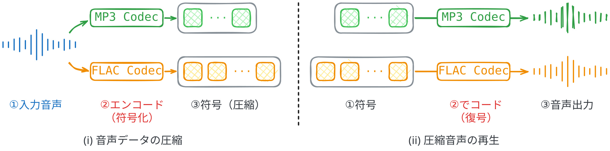
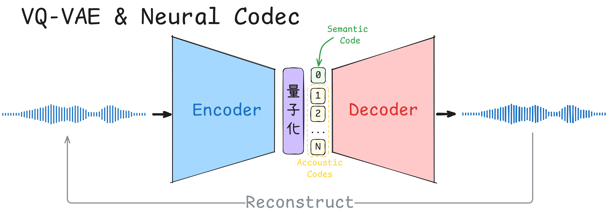
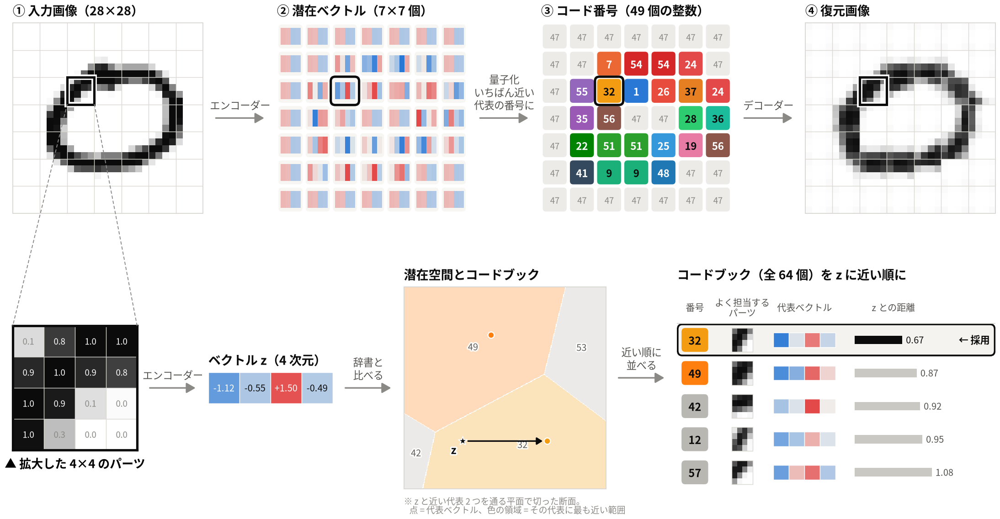
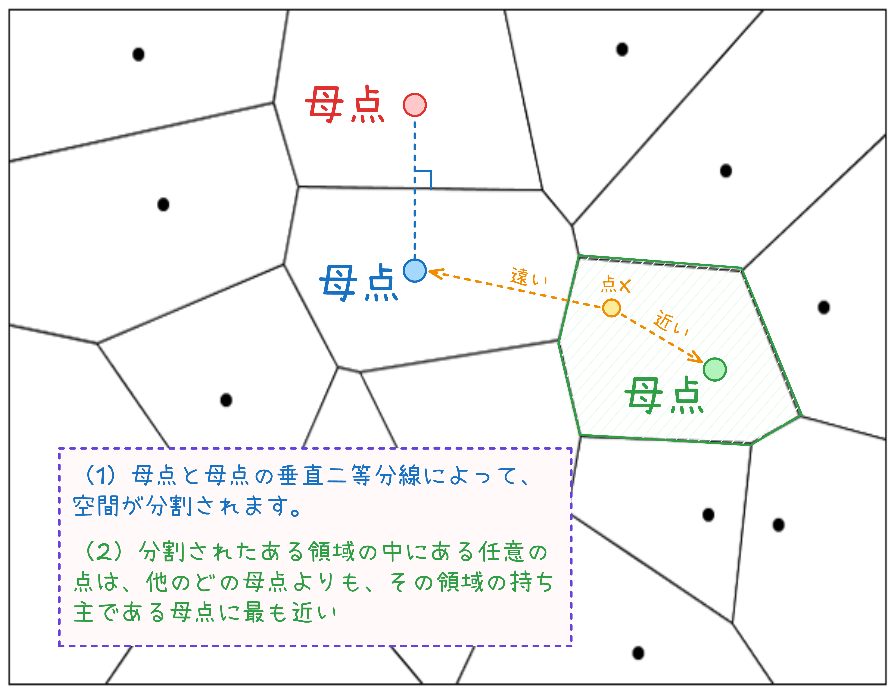
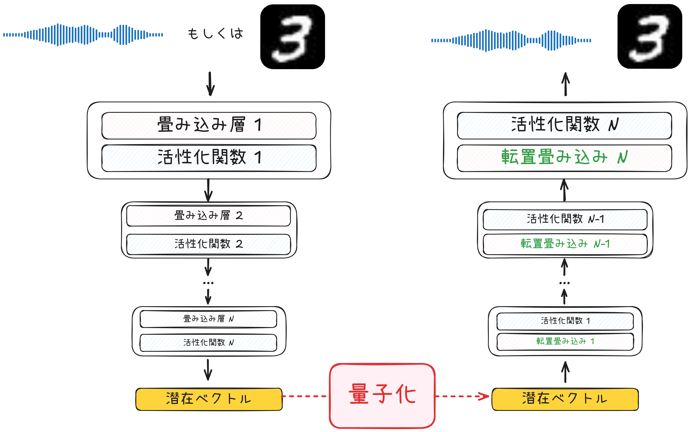
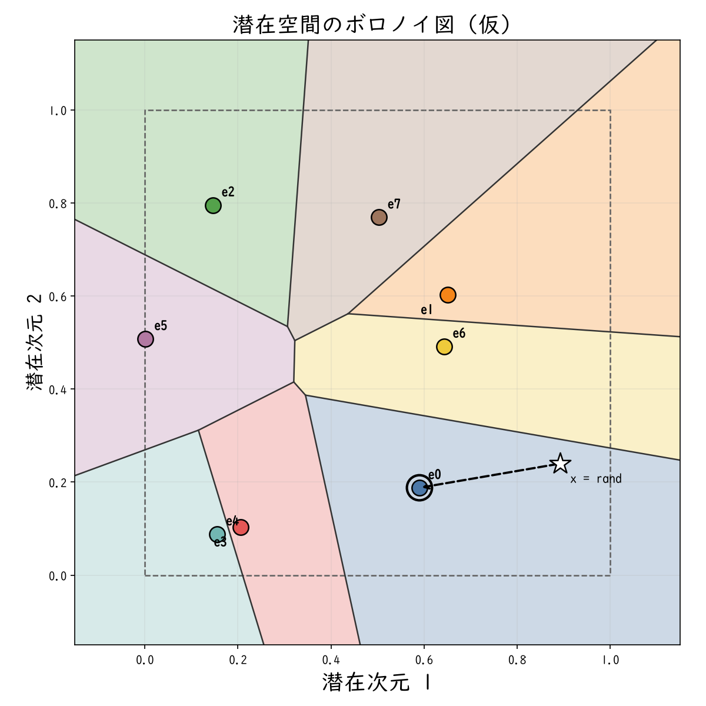
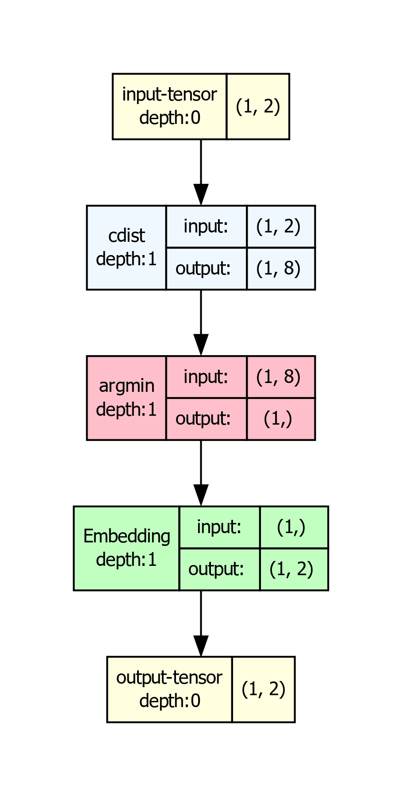
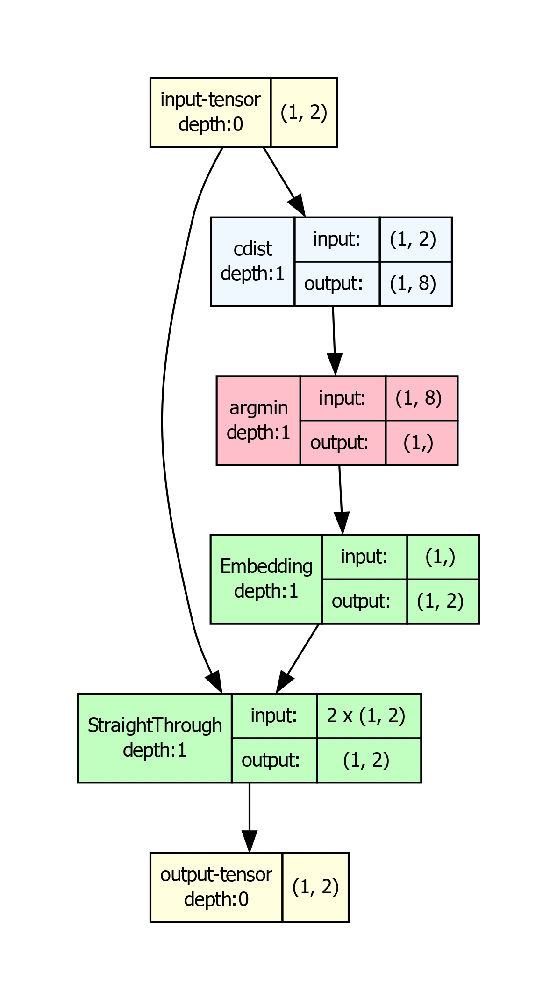
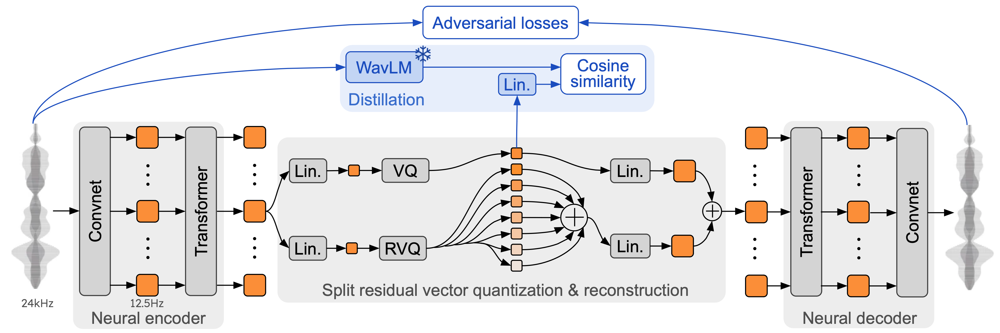

## 「スマホから聞こえる相手の声は、実は本人の声ではない」

めたん：突然ですが、「スマホから聞こえる相手の声は、本人の声そのものではない」って知っていましたか？

ずんだもん：どういうことなのだ？ しゃべってるのは本人なのだ。


つむぎ：電話線にそのまま声を乗せることはできないから、いったん電気信号に変換するときに誤差が生じるってこと？

めたん：その通りです。声はいったんコンパクトな符号に変換されてから送られ、受け取った側でその符号から「合成音声」を作って流しています。つまり電話越しに聞こえるのは、あくまで「符号から作り直した声」であって、厳密には「本人によく似た別の声」なんです。

ずんだもん：電話の声って音質が悪いもんね。符号化したときに、情報が削られてるからなのだ。でも、「本人じゃない！」って思ったことはないのだ。

めたん：そこが面白いところです。多少音質が落ちても、私たちは本人の声として受け入れます。音楽ならなおさらで、MP3とFLACを聞き分けられる人はほとんどいません。

ずんだもん：人間の感覚って、意外と大雑把なのだ。

めたん：そうなんです。だからこそ多くのコーデックのように、「人間の感覚では気づきにくい情報を削って、データを小さくする」という技術が成り立ちます。

## Neural Codec

ずんだもん：そもそもコーデックってなんなのだ？



つむぎ：コーデックとは、データを符号に変換したり、符号からデータを復元したりするための仕組みだよ。例えばさっき出てきた「MP3」や「FLAC」は音楽の有名なCodecだし、画像だと「JPEG」なんかも有名だね。

めたん：Neural Codecは、深層学習を使ったCodecです。従来の手法とは圧縮性能が桁違いなんです。実際に聞き比べてみましょう。まずは原音から。

<audio controls src="../chaps/assets/chap2_tokenizer/audio/reference_48k.wav" title="Title"></audio>

めたん：次に、ネット通話でよく使われる従来型のCodec「Opus」を、Neural Codecの一つであるMimiと同じくらいのサイズまで落とすと、こうなります。

<audio controls src="../chaps/assets/chap2_tokenizer/audio/opus_2.2k.wav" title="Title"></audio>

ずんだもん：うわ、ガビガビで何を言ってるのか分からないのだ！

めたん：では、同じくらいのビットレートでMimiを使うと……

<!-- TODO: Mimiで圧縮・復元した音声のパスを入れる -->
<audio controls src="../chaps/assets/chap2_tokenizer/audio/qwen3_48k.wav" title="Title"></audio>

ずんだもん：ほとんど元の声と同じなのだ！ どうやってるのだ？

めたん：実は、VQ-VAEという手法を使って……

つむぎ：はいはいはい！ それってよく画像生成にも使われる手法だよね。

### VQ-VAE



つむぎ：VQ-VAEは、ペアになった2つのモデルでできてるの。1つ目の**エンコーダー**がデータを短い符号に変換して、2つ目の**デコーダー**が符号から元のデータを復元する。その間に**量子化**をはさんで、符号を「番号」、つまり離散的なトークンにしちゃうって感じかな。

めたん：言葉だけだと分かりにくいですから、画像の例で見てみましょう。



つむぎ：MNISTの手書き数字でやってみるね。まず、$28 \times 28$ の画像を $4 \times 4$ の小さなパーツに切り分けるよ。縦7個×横7個で、全部で49個になるね。次に、エンコーダーが各パーツを1本の短いベクトルに変換する。最後に、そのベクトルを「よく出てくる代表的なパターン」のうちいちばん似ているものに置き換えて、その番号だけを残すの。

そうすると、$28 \times 28 = 784$ ピクセルの画像が、たった49個の整数で表せちゃうってわけ。図の真ん中を見てね。何も書かれていない背景のパーツは、全部同じ「22番」になってるでしょ？

ずんだもん：なるほど！ エンコーダーが $4 \times 4$ の画像を4次元のベクトルにいったん圧縮して、特徴的なパターンに番号を付けて、その番号で画像を代用するのだね。

めたん：その代表パターンの一覧が、いわば「辞書」の役割を果たします。専門用語では**コードブック**と呼びます。

仕組みを整理すると、こうなります。

1. エンコーダーが、データを「潜在空間」と呼ばれるベクトルの空間に写す。
2. 潜在空間の中に代表点（コードブック）をいくつか用意して、各ベクトルをいちばん近い代表点に置き換える。
3. デコーダーが、代表点から元のデータを復元する。

このとき潜在空間は「どの代表点にいちばん近いか」で区切られるので、ボロノイ図のような形になります。



めたん：ポイントは、代表点を人の手で選ぶ必要がないことです。エンコーダーもデコーダーもコードブックも、すべてデータから自動的に学習されます。実際に学習を回すと、このようになります。

<video controls>
  <source src="../chaps/assets/chap2_tokenizer/learningVqvae.mp4" type="video/mp4">
</video>

めたん：ちなみに音声の場合も考え方は同じで、2次元の画像の代わりに1次元の波形を扱うだけです。

ずんだもん：四捨五入みたいなものなのだ！ 少し情報を捨ててもだいたい復元できるように空間を分割して、その中に代表点を置いて、周りの点をぜんぶ代表点に寄せる。そうすれば、代表点の番号だけ送ればいいのだ！ ……でも、具体的にはどうやって学習するのだ？

めたん：ここからは、実際にPyTorchのコードを見ながら仕組みを確かめていきましょう。コードが難しいと感じる方は、考え方だけ拾って「MioCodecで実際に試してみよう」まで読み飛ばしても大丈夫ですよ。

### Encoder & Decoder

つむぎ：引き続き、分かりやすい画像の例で説明するね。まずはエンコーダーとデコーダーから始めよう。基本的には、こんな構造になるよ。



ずんだもん：これは由緒正しい、畳み込みニューラルネットワークの構造なのだ。

めたん：はい。ちなみに、最新鋭のモデルでも、この部分の構造は昔からあるシンプルな構成を流用しているケースが多いんですよ。

つむぎ：コードに落とすとこんな感じだよ。

```python
import torch
import torch.nn as nn
import torch.nn.functional as F

DIM = 4  # 潜在ベクトルの次元数


class VQVAE(nn.Module):
    def __init__(self, latent_dim: int = DIM):
        super().__init__()
        # kernel = stride = 2 → 畳み込みの窓が重ならない
        # 2 層で縦横 1/4 になる（28 → 7）。潜在ベクトル 1 つ => 4×4 ピクセルのパッチ 1 つ
        self.enc = nn.Sequential(
            nn.Conv2d(in_channels=1, out_channels=32, kernel_size=2, stride=2),
            nn.GELU(),
            nn.Conv2d(in_channels=32, out_channels=latent_dim, kernel_size=2, stride=2),
        )

        # エンコーダと対称な構成（7 → 28 に戻す）
        self.dec = nn.Sequential(
            nn.ConvTranspose2d(in_channels=latent_dim, out_channels=32, kernel_size=2, stride=2),
            nn.GELU(),
            nn.ConvTranspose2d(in_channels=32, out_channels=1, kernel_size=2, stride=2),
            nn.Sigmoid(),
        )
```

ずんだもん：ここは昔ながらのPyTorchの基本的な書き方って感じがして、懐かしいのだ。

### Vector Quantize

つむぎ：そして、肝心なのがVQ（ベクトル量子化）の部分。エンコーダーが出した潜在ベクトルは、そのままデコーダーに渡すのではなく、いったん潜在空間の中でいちばん近い代表点に置き換えてから渡すんだよ。

めたん：まずは、コードブックを定義します。潜在空間にいくつの代表点（母点）を用意するか、つまり「辞書のサイズ」を決めるということですね。

```python
class VectorQuantizer(nn.Module):
    def __init__(self, codebook_size: int, latent_dim: int):
        super().__init__()
        self.embedding = nn.Embedding(codebook_size, latent_dim)
        nn.init.uniform_(self.embedding.weight, -1 / codebook_size, 1 / codebook_size)

    def quantize(self, x):
        # 全コードとのユークリッド距離を計算し、最も近いコードを選ぶ
        idx = torch.cdist(x, self.embedding.weight).argmin(-1)
        z = self.embedding.weight[idx]
        # Straight-Through 方式：順伝播では z を使い、逆伝播では勾配を x にそのまま流す
        z_q = x + (z - x).detach()
        return z_q, idx

    def forward(self, x):
        return self.quantize(x)
```

つむぎ：結構シンプルなコードだね。

めたん：ええ。初期化関数でコードブックを定義し、`quantize` 関数でいちばん距離が近いコードを探して、その値とIDを返すだけです。適当な乱数を入れて可視化すると、こんな感じになります。

```python
vq = VectorQuantizer(codebook_size=8, latent_dim=2)
rand = torch.rand((1, 2))
```



ずんだもん：あの変な式はなんなのだ？ `.detach()` って書いてあるのだ。

つむぎ：あれはね、「いちばん小さい値を探す（`argmin`）」という操作は微分できないから、そのままでは勾配がここで途切れてしまうんだよ。

めたん：深層学習では、モデル全体で連鎖律によって勾配を計算してパラメータを更新する必要があります。もし途中で勾配が途切れてしまうと、エンコーダー側が学習できなくなってしまうのです。

つむぎ：だから、この「最小値を探す」操作を無視して、勾配をそのまま通り抜けさせるやり方が **Straight-Through** 方式だよ。`.detach()` はその部分を勾配計算から外すという意味で、数値としては `z_q` は `z` と同じになるのに、逆伝播のときだけ勾配が `x` にそのままコピーされるんだ。

| 通り抜けない | 通り抜ける |
| :---: | :---: |
|  |  |

### コードブックの学習方法

つむぎ：これでエンコーダーとデコーダーは学習できるようになったね。でも、まだ1つ抜けているものがあるんだよ。

ずんだもん：……コードブックなのだ？

つむぎ：正解！ Straight-Throughの式を見直すと、コードブックから取り出した `z` は `.detach()` の中に入ってるよね。つまり、復元の誤差からはコードブックに勾配が1ミリも流れないの。

めたん：そこで、コードブック専用の損失を別に用意します。次の2つの損失です。

```python
# 第1項: コードブックをエンコーダ出力に近づける（エンコーダ側は固定）
# 第2項: エンコーダ出力をコードに近づける＝Commitment Loss（コードブック側は固定）
codebook_loss = F.mse_loss(q, z.detach())
commitment_loss = F.mse_loss(z, q.detach())
vq_loss = codebook_loss + BETA * commitment_loss
```

つむぎ：ボロノイ図で言えば、`codebook_loss` は母点を点の集まりの中心へ動かして、`commitment_loss` は点を母点の近くに留めておく役割だよ。両側から歩み寄らせる感じだね。

めたん：`BETA` は、エンコーダー側をどれだけ強く縛るかの重みです。元のVQ-VAEの論文では `0.25` が使われていて、ここでもそれに合わせています。代表点を動かすほうが主役で、エンコーダーへの縛りは控えめ、というバランスですね。

ずんだもん：ここにも `.detach()` が入ってるのはなんでなのだ？ `F.mse_loss(q, z)` だけじゃダメなのだ？

めたん：もし `.detach()` を付けずに `F.mse_loss(q, z)` だけで計算すると、コードブック（`q`）とエンコーダー（`z`）の**両方**に同じ強さ（1:1）で勾配が流れてしまいます。

つむぎ：だから `.detach()` で片方を定数として固定して2つの項に分けることで、コードブック側の更新とエンコーダー側の更新の強さを `BETA` で別々に調整できるようにしてるんだよ。

ずんだもん：なるほど、片方ずつ引っ張る強さを変えるためなのだ！

#### 完成版

つむぎ：それじゃあ、ここまでの部品を全部組み合わせて、VQ-VAEの完成版を見てみよう。圧縮して送るときに必要な代表点の番号（`idx`）も一緒に返すようにしてあるよ。

```python
# DIM   : 潜在ベクトルの次元数
# CODES : コードブックのサイズ（コード数）
# BETA  : Commitment Loss の重み
DIM, CODES, BETA = 4, 64, 0.25


class VectorQuantizer(nn.Module):
    def __init__(self, codebook_size: int, latent_dim: int, beta: float = BETA):
        super().__init__()
        self.beta = beta
        self.embedding = nn.Embedding(codebook_size, latent_dim)
        nn.init.uniform_(self.embedding.weight, -1 / codebook_size, 1 / codebook_size)

    def quantize(self, z):
        # 全コードとのユークリッド距離を計算し、最も近いコードを選ぶ
        idx = torch.cdist(z, self.embedding.weight).argmin(-1)
        q = self.embedding.weight[idx]

        # 第1項: コードブックをエンコーダ出力に近づける（エンコーダ側は固定）
        # 第2項: エンコーダ出力をコードに近づける＝Commitment Loss（コードブック側は固定）
        codebook_loss = F.mse_loss(q, z.detach())
        commitment_loss = F.mse_loss(z, q.detach())
        vq_loss = codebook_loss + self.beta * commitment_loss

        # Straight-Through 推定：順伝播では q を使い、逆伝播では勾配を z にそのまま流す
        z_q = z + (q - z).detach()
        return z_q, idx, vq_loss

    def forward(self, z):
        return self.quantize(z)


class VQVAE(nn.Module):
    def __init__(self, latent_dim: int = DIM, codebook_size: int = CODES, beta: float = BETA):
        super().__init__()
        # kernel = stride = 2 → 畳み込みの窓が重ならない
        # 2 層で縦横 1/4 になる（28 → 7）。潜在ベクトル 1 つ => 4×4 ピクセルのパッチ 1 つ
        self.enc = nn.Sequential(
            nn.Conv2d(in_channels=1, out_channels=32, kernel_size=2, stride=2),
            nn.GELU(),
            nn.Conv2d(in_channels=32, out_channels=latent_dim, kernel_size=2, stride=2),
        )

        # エンコーダと対称な構成（7 → 28 に戻す）
        self.dec = nn.Sequential(
            nn.ConvTranspose2d(in_channels=latent_dim, out_channels=32, kernel_size=2, stride=2),
            nn.GELU(),
            nn.ConvTranspose2d(in_channels=32, out_channels=1, kernel_size=2, stride=2),
            nn.Sigmoid(),
        )

        self.latent_dim = latent_dim
        self.quantizer = VectorQuantizer(codebook_size, latent_dim, beta)

    def encode(self, x):
        """
        x: (B, 1, 28, 28)
        戻り値: z_q     (B*7*7, DIM) 量子化後の潜在ベクトル
                idx     (B*7*7,)     各ベクトルに最も近いコード番号
                vq_loss ()           VQ損失
        """
        z_raw = self.enc(x)  # (B, DIM, 7, 7)
        # チャネル（＝潜在次元）を最後に移し、位置ごとのベクトルをすべて1行に並べる
        z = z_raw.permute(0, 2, 3, 1).reshape(-1, self.latent_dim)
        return self.quantizer(z)

    def decode(self, z_q):
        return self.dec(z_q)

    def forward(self, x):
        z_q, idx, vq_loss = self.encode(x)
        # (B*7*7, DIM) → (B, DIM, 7, 7) に戻してデコーダへ
        z_q = z_q.view(len(x), 7, 7, self.latent_dim).permute(0, 3, 1, 2)
        return self.decode(z_q), vq_loss, idx
```

つむぎ：完璧！

めたん：ここまで画像で実装してきましたが、音声の場合も `Conv2d` が1次元の `Conv1d` に変わり、49個のパッチの代わりに「1秒あたり数十個の時間フレーム」が並ぶだけで、仕組みはまったく同じです。

### MioCodecで実際に試してみよう

めたん：それでは、実際の音声用コーデックである **MioCodec** を使って、簡単に実験してみましょう。

MioCodecは、音声を離散的なトークンに変換するモデルですが、話者のアイデンティティや声質といった特徴を、トークンとは別のベクトルとして取り出すように設計されています。

つむぎ：「何を話すか」と「誰の声で話すか」を分けるってことだね。考え方としては納得だけど、話者の特徴ってたった1本のベクトルで表現しきれるものなの？

めたん：正直なところ、細かいニュアンスまでは表現しきれない部分もありますが、実用上は十分な性能が出ます。実際に聞いてみましょう。例えば、こちらの「つくよみちゃん」の音声を入力してみます。

<audio controls src="mio_original.wav" title="Title"></audio>

めたん：すると、このようなトークン列に変換されます。

```python
tensor([ 2041, 9600, 204, 11282, 1787, ...(全173個)..., 7550], device='cuda:0')
```

めたん：この音声の長さは $6.91$ 秒で、フレームレートは $25\text{Hz}$（1秒あたり25トークン）なので、合計173個のトークンになりました。これらのトークンと、つくよみちゃんの声の特徴ベクトルを合わせて再構築した音声がこちらです。

<audio controls src="mio_reconstructed.wav" title="Title"></audio>

ずんだもん：たった173個の数字から、ちゃんと元の声に戻ってるのだ！

めたん：そして面白いのはここからです。このトークンが表しているのは主に「何を話しているか」という内容です。つまり、トークンはそのままにして、別の話者の特徴ベクトルだけを入れ替えることもできるんです。

例えば、こちらのひろゆきさんの参考音声から声の特徴ベクトルを取り出して入れ替えると……

<audio controls src="hiroyuki.wav" title="Title"></audio>

めたん：つくよみちゃんのセリフを話すひろゆきさんの出来上がりです。

<audio controls src="tsukuyomi_hiroyuki.wav" title="Title"></audio>

ずんだもん：おおっ、声だけ入れ替わってるのだ！ すごいのだ！

めたん：さらに、この仕組みは言語をまたいで使うこともできます。例えば、ケネディ大統領の英語の演説を、つくよみちゃんの声に変換することもできるんです。

| 元の音声（ケネディ大統領） | つくよみちゃん変換後 |
| :---: | :---: |
| <audio controls src="source.wav" title="Title"></audio> | <audio controls src="nearest.wav" title="Title"></audio> |

つむぎ：英語の演説までそのまま声だけ変わるんだ。トークンと声質がきれいに分離できてる証拠だね。

### Residual Vector Quantizer（残差ベクトル量子化）

めたん：では最後にもう一つ、さらに音質を高めるための仕組みとして、残差ベクトル量子化（RVQ）を紹介します。さっきトークン列に一つのベクトルを追加するだけでは、話者の音質を全部表現しきれないという欠点があって、それを改善するため、どうすればいいと思いますか？

ずんだもん：一つのベクトルだと、音質の情報を全部表せないなら、もっと音質情報を追加するとか？

めたん：大体その通り。MioCodecの場合、音質情報はどれだけ入力が長いでも、固定な長さの128次元のベクトルしか情報を記録できない。より多くの音質情報を記録するための手法として、RVQがよくつかわれる。いわば、フレームごとに音質を記録するというやり方です。

つむぎ：なるほど、力押しなのか。１フレーム１トークンから、１フレーム数トークンにすれば、その記録できる情報量も数倍に増えるというわけか。って、RVQを使うというのは、「何を話すか」と「どう話すか」を一つの空間の中にまとめて

めたん：それは潜在空間をまんべんなく母点で塗りつくすのと同じことなので、計算量やメモリ的に現実的ではありません。そこで、残った誤差を別のコードブックでもう一度量子化し、これを繰り返して最後に全部足し合わせます。

つむぎ：数字でいうと、$3.14159$ を「$3$」「$0.1$」「$0.04$」……と、大まかな値から順に直していく感じだね。

| 段 | 残差 | 量子化 | 合計 |
| :---: | ---: | ---: | ---: |
| 1 | 3.14159 | 3 | 3 |
| 2 | 0.14159 | 0.1 | 3.1 |
| 3 | 0.04159 | 0.04 | 3.14 |

めたん：しかも、1024個のコードブックを8段重ねれば、代表点は8192個だけで $1024^8$ 通りを表せます。

ずんだもん：小さい辞書を何冊も組み合わせるのだ！

めたん：実装は、先ほどの `VectorQuantizer` を段の数だけ並べるだけです。

```python
class ResidualVectorQuantizer(nn.Module):
    def __init__(self, num_quantizers: int, codebook_size: int, latent_dim: int, beta: float = BETA):
        super().__init__()
        self.layers = nn.ModuleList(
            [VectorQuantizer(codebook_size, latent_dim, beta) for _ in range(num_quantizers)]
        )

    def quantize(self, x):
        residual = x
        z_q = torch.zeros_like(x)
        indices = []
        total_vq_loss = 0.0

        for vq in self.layers:
            q, idx, vq_loss = vq.quantize(residual)  # 各段で Straight-Through 込みの普通の VQ
            z_q = z_q + q
            residual = residual - q.detach()         # 表せなかった残りを次の段へ
            indices.append(idx)
            total_vq_loss = total_vq_loss + vq_loss

        return z_q, torch.stack(indices, dim=-1), total_vq_loss

    def forward(self, x):
        return self.quantize(x)
```

つむぎ：残りを次の段に渡してるだけだね。使う段数を変えれば、音質と通信量のバランスも調整できるよ。

めたん：それでは、実際のNeural Codecで使うコードブックの数を変えながら聞き比べてみましょう。なお、実際の最新モデルでは、基本のRVQにもう一つ面白い工夫が足されています。それを意識しながら聞いてみてください。まずは元の録音から。

<audio controls src="assets/chap2_tokenizer/audio/codebooks_ablation/original.wav" title="Title"></audio>

| 使ったコードブック | 合成音声 |
| ---: | --- |
| 1個（cb0） | <audio controls src="assets/chap2_tokenizer/audio/codebooks_ablation/original_codec_k01.wav" title="Title"></audio> |
| 2個 | <audio controls src="assets/chap2_tokenizer/audio/codebooks_ablation/original_codec_k02.wav" title="Title"></audio> |
| 3個 | <audio controls src="assets/chap2_tokenizer/audio/codebooks_ablation/original_codec_k03.wav" title="Title"></audio> |
| 5個 | <audio controls src="assets/chap2_tokenizer/audio/codebooks_ablation/original_codec_k05.wav" title="Title"></audio> |
| 9個 | <audio controls src="assets/chap2_tokenizer/audio/codebooks_ablation/original_codec_k09.wav" title="Title"></audio> |
| 16個（すべて） | <audio controls src="assets/chap2_tokenizer/audio/codebooks_ablation/original_codec_k16.wav" title="Title"></audio> |

ずんだもん：増やすほど元の声に近づくのだ！ でも、cb0だけだとノイズみたいなのだ。



めたん：そこが先ほどお伝えした工夫です。このモデルではcb0だけ特別で、別のモデルから「何を話しているか」という意味の情報を蒸留して学習しています。話の中身やリズムは入っていても声色はほとんど入っていないので、それだけではノイズに聞こえるんです。声らしさを足すのはcb1以降の役目ですね。ただ、それ以外に原理上の大きな違いはなく、構造こそ複雑になったものの、基本の形は今日説明したシンプルなVQ-VAEと同じです。

## まとめ

めたん：最後に、今回の内容を振り返りましょう。

- **Codec**：データを符号に変換し、符号から復元する仕組み。人間の感覚では気づきにくい情報を捨てて、データ量を減らす。
- **VQ-VAE**：エンコーダーでデータを潜在ベクトルに変換し、コードブックのいちばん近い代表点に置き換え（量子化）、デコーダーで復元する。データは「代表点の番号」の列として送れる。
- **学習の工夫**：`argmin` は微分できないため、Straight-Throughで勾配を通す。コードブックは `Codebook Loss` と `Commitment Loss` で学習する。
- **RVQ（残差ベクトル量子化）**：残った誤差を別のコードブックで繰り返し量子化して、精度を上げる。使う段数で、音質と通信量のバランスを調整できる。

## 参考文献

- https://zenn.dev/aratako_lm/articles/1214925e96bd58
- https://note.com/kikaben/n/nea10e7706656