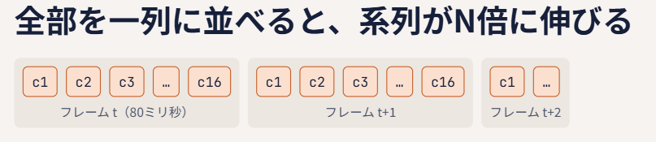
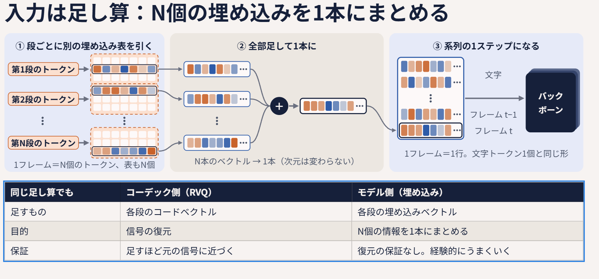
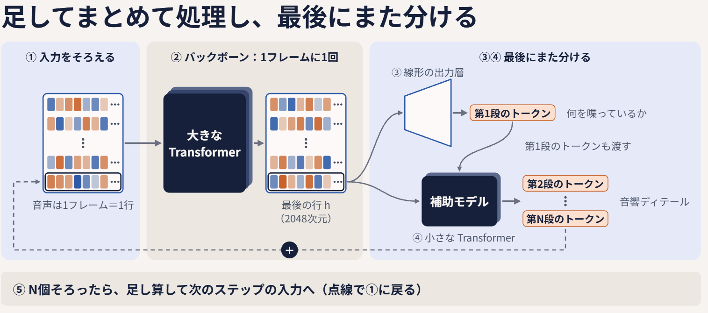

めたん：それでは、いよいよ一番肝心な部分。音声言語モデルの背骨たる「言語モデル」、つまりトークンから次のトークンを予測する仕組みについて話しましょう。

ずんだもん：いったんストップなのだ。そもそも、言語モデルで音声トークンを予測するなんて本当にできるのだ？

つむぎ：たしかに。文字と音声のトークンじゃ性質が違いすぎない？ テキストで事前学習したモデルを、そんなあっさり転用できるもんかな。

めたん：結論から言うと、驚くほどあっさりできますの。理由を理解するために、まず言語モデルの構造を復習しましょう。

## 復習：言語モデルは「入口・胴体・出口」の三段構造

つむぎ：復習はあーしが。Qwen3 1.7B を例にすると、こんな三段だよ。

<!-- 図：埋め込み表 → Transformer層 × L → 出力層（LMヘッド） -->


- 入口（埋め込み表）：トークンIDをベクトルに変換する。語彙サイズは151,936なので、表も151,936行。1行が2048次元のベクトルで、トークン1個につき1行を引くだけ。
- 胴体（Transformer層）：2048次元のベクトル列を受け取り、同じ2048次元のベクトル列を返す。ここはトークンIDを直接見ていない。見ているのはベクトルだけ。
- 出口（出力層）：最後のベクトルを線形層で語彙サイズ次元のスコアに写し、次のトークンの確率分布にする。

これを繰り返すことで、長い文章も生成できるってわけ。

ずんだもん：つまり、語彙量とつながっているのは入口と出口だけ。真ん中のTransformerはベクトル列しか見ていないのだ。

つむぎ：その通り。だから語彙を増やしたいときは……


ずんだもん：埋め込み表と出力層に行を足すだけで、真ん中はそのままでいいのだ！

つむぎ：正解。ツール呼び出し用の特殊トークンを追加するときにもよく使われる、ごく普通の手法だよ。

めたん：そして胴体にとっては、入ってくるベクトルが文字由来か音声由来かは関係ありません。「系列の続きを予測する」という課題は同じですもの。新しく足した行さえ学習できれば、同じ胴体で音声も扱えますの。

## 1フレーム＝1トークンの場合：Llasa と MioTTS

めたん：この発想を一番素直に実行したのが、2025年に発表された Llasa ですわ。Llama の語彙に音声トークンを65,536個追加し、音声データで学習を続けたモデルですの。1フレームを1トークンで表すコーデックを使うので、文字トークンと音声トークンをそのまま一列に並べられますわ。

ずんだもん：モデルの構造はどこを改造したのだ？

めたん：語彙サイズ以外、何も。胴体は Llama のままですわ。

つむぎ：へー、本当に入口と出口だけなんだ。

めたん：ただし、足した行はゼロから学習するので、約25万時間もの音声データを使っていますの。

つむぎ：構造はあっさりでも、データ量はあっさりしてないわけね。

めたん：なお、音声トークンを言語モデルに予測させる発想自体は以前からありました。Llasa の意義は、「単一コードブック＋素の言語モデル」まで削ぎ落としても十分な品質が出ると示したことですわ。

つむぎ：日本語だとどうなの？

めたん：Aratako 氏が2026年に公開した MioTTS が、ほぼ同じレシピで作られていますわ。コーデックは毎秒25トークンのMioCodec、ベースの言語モデルも軽量なものに変わっていますが、「単一のトークン列を素の言語モデルで予測する」という発想は同じ。モデルへの入力は、ただの文字のプロンプトだけですの。

```python
<|im_start|>user
だが断る<|im_end|>
<|im_start|>assistant
```

つむぎ：出力は？

```python
<|im_start|>user
だが断る<|im_end|>
<|im_start|>assistant
<|s_12799|><|s_11619|>...<|s_9149|><|im_end|>  # 35個の音声トークン
```

ずんだもん：普通の言語モデルの出力と同じ形なのだ。この <|s_…|> の一つひとつが、追加した音声トークンなのだ。

ずんだもん：でも、声の指定がどこにもないのだ。どうやってつくよみちゃんの声にするのだ？
 
めたん：そこが役割分担ですわ。
 
- 言語モデル：「何を喋るか」を担当。発音や抑揚を表すトークンだけを生成する
- MioCodec：「どう聞こえるか」を担当。トークンを音声に戻すとき、声色や音質を参考音声から補う
 
めたん：つくよみちゃんの音声を参考音声にすると、こうなりますわ。
 
<audio controls src="assets/chap3_SLM/audio/output_kotowaru.wav" title="Title"></audio>
 
めたん：参考音声を指定せずに生成すると、同じトークンでも声はまったく別人になります。
 
<audio controls src="assets/chap3_SLM/audio/RAWoutput.wav" title="Title"></audio>
 
つむぎ：喋ってる中身は同じなのに、声だけ入れ替わってる。役割分担がはっきり聞き取れるね。
 
めたん：少し長いセリフだと、こんな感じですわ。
 
<audio controls src="assets/chap3_SLM/audio/Diooutput.wav" title="Title"></audio>
 
ずんだもん：普通に使えるけど、少しノイズっぽいし、つくよみちゃんにもあまり似てないのだ。……やっぱり言語モデルに音声を予測させるのは無理があるのではないのだ？

つむぎ：早合点じゃない？ 音が出るまでには「言語モデル」と「コーデック」の二段があるんだから、どっちが原因か切り分けないと。

めたん：では切り分けましょう。言語モデルを通さず、本物の音声を MioCodec でトークンにして、そのまま音声に戻した例ですわ。言語モデルが完璧に予測できた場合の音、つまりこのシステムの音質の上限です。

<audio controls src="audio/MioTTS/VOICEACTRESS100_001.wav" title="Title"></audio>
<audio controls src="audio/MioTTS/reconstructed.wav" title="Title"></audio>

つむぎ：ほらね、同じようなノイズが乗ってるし、つくよみちゃんらしさも少し薄れてる。

ずんだもん：ボトルネックはコーデックの方だったのだ。1フレームを1トークンで表すと、「どう聞こえるか」の細部まで載せきれないのだ。もっと綺麗にする方法はあるのだ？

## 1フレームのN個のトークンをどう扱うか

めたん：MioTTSは「何を喋るか」と「どう聞こえるか」を分けていましたわよね。それって、何かと似てない

つむぎ：あっそうだ、ＲＶＱだ、でも


つむぎ：RVQ は、前の段で量子化しきれなかった残差を次の段が量子化する仕組みだから、後ろの段ほど担う情報は小さくなる。しかも最近のコーデックは、第1段に「何を喋っているか」という意味的な情報を、残りの段に声の質感などの音響的な細部を持たせるように学習してるんだよね。


ずんだもん：第1段が「何を」、残りの段が「どう」。MioTTSでの役割分担と、そっくりなのだ！
 
めたん：RVQなら、細かい情報もフレームごとのトークンとして表せる。つまり、声の細部までモデルが予測できるようになるのですわ。

ずんだもん：でも RVQ だと1フレームにN個のトークンが同時に出てくるのだ。言語モデルは一列の系列しか扱えないのに、どうするのだ？

つむぎ：一番安直なのは、全コードブックのトークンの埋め込みをそのまま一列に並べる、とか？

<!-- 図：フラット化。フレーム t の [c1, c2, …, cN] を横一列に展開 -->


めたん：原理的には可能ですわ。ただ、系列の長さがN倍になりますの。16段のコードブックで毎秒12.5フレームなら毎秒200トークン。1秒の音声を作るのに、大きなモデルを200回も回すことになりますわ。

つむぎ：系列が長いぶん、Attention の計算もメモリも重くなる。これじゃ推論が遅すぎるね。

<!-- 追加実験案④【優先度：低／手間：小】コストの数字を表にする -->

## 二段構え：「何を」は大きなモデル、「どう」は小さなモデル

めたん：ここでもう一度、MioTTS の分担を思い出してくださいまし。大きな言語モデルは「何を」だけに専念し、「どう」は別の仕組みに任せていました。同じ分担を、モデルの中に持ち込めばよいのですわ。
 
- 大きなモデル（バックボーン）：時間方向の流れと第1段、つまり「何を」を予測する
- 小さな補助モデル：残りの段、つまり「どう」を予測する
 
ずんだもん：MioTTS でコーデックが参考音声から補っていた部分を、小さなモデルがフレームごとに予測するようになったのだ。
 
つむぎ：出力側はわかった。でも入力側は？ 前のフレームのN個ぶんの情報を全部渡さないと、情報が欠けちゃうじゃん。



めたん：そこは足し算ですわ。コードブックごとに埋め込み表を用意し、1フレームぶんのN個の埋め込みベクトルを足して1本にしますの。

ずんだもん：RVQ のデコードも各段のベクトルの足し算だったのだ。同じことなのだ？

めたん：形は同じでも意味は別物ですわ。コーデックの足し算は、残差を足し戻すほど元の信号に近づくことが定義から保証されています。一方、モデル側の足し算は、N個の情報を1本に押し込むための操作にすぎず、元のN個を取り出せる保証はありません。それでも、2048次元は十分に広く、段ごとに別の埋め込み表を使うので、区別のつく表現が学習できる。「経験的にうまくいく」方法ですわね。

つむぎ：流れをまとめると、こうでしょ。

<!-- 図：フレーム t-1 のN個の埋め込みを加算 → バックボーン → h_t → 第1段ヘッド ＋ 補助モデル → フレーム t のN個 -->

1. 入力をそろえる：文字は通常の埋め込みに。音声は1フレームN個のトークンを各段の埋め込み表で引き、足して1本に。どちらも2048次元のベクトル1本なので、「1フレーム＝系列の1ステップ」として扱える
2. 大きなモデル（バックボーン）を1ステップ回し、出力ベクトルを得る
3. 出力ベクトルから、出力層で第1段のトークンを予測する
4. 出力ベクトルと第1段のトークンを小さな補助モデルに渡し、残りのN−1個を予測する
5. N個そろったら、また足して次のステップの入力にする

ずんだもん：足してまとめて処理して、最後にまたばらすのだ。大きなモデルは1フレームにつき1回しか回らないから、一列に並べるよりずっと速いのだ。

## Fish Audio S2

めたん：この方式の代表例が、Fish Audio S2 Pro ですわ。



- コーデック：RVQ、10段のコードブック、毎秒約21フレーム
- 大きなモデル（約4B パラメータ）：時間方向に1フレームずつ進み、第1段、つまり「何を」を予測する
- 小さな補助モデル（約0.4B パラメータ）：各フレームで残りの9段、つまり「どう」を予測する

つむぎ：計算してみよっか。10段×毎秒21フレームを一列に並べたら、大きなモデルを毎秒約210回も回すことになる。でもこの二段構えなら、大きなモデルは毎秒21回で済む。補助モデルは毎フレーム回るけど、小さいから軽いってわけ。

めたん：しかも、この構成は普通の言語モデルと同じ形をしていますから、LLM 向けに作られた推論の高速化技術をそのまま使えますの。これを使ってできる音声はこのように

<audio controls src="assets/chap3_SLM/audio/Dio_fish.wav" title="Title"></audio>

ずんだもん：おっ、これはなかな

## まとめ

ずんだもん：まとめるのだ。1フレーム1トークンなら、語彙を足すだけの Llasa 型。1フレーム複数トークンなら、足し算と補助モデルを組み合わせた二段構え型なのだ。

- 言語モデルで語彙とつながっているのは入口（埋め込み表）と出口（出力層）だけ。行を足せば、胴体はそのままで音声トークンも扱える。
- 1フレーム1トークンのコーデックなら、語彙拡張だけで音声を生成できる（Llasa、MioTTS）。ただし音質の上限はコーデックで決まる。
- RVQ で1フレームに複数トークンを使う場合は、埋め込みの足し算で入力をまとめ、大きなモデルが第1段を、小さな補助モデルが残りの段を予測する二段構えにする（Qwen3-TTS、Fish Audio S2）。


参考文献
- Llasa: https://arxiv.org/pdf/2502.04128
- Llasa の日本語ファインチューニング解説（Aratako 氏）: https://zenn.dev/aratako_lm/articles/7e0b0b6e51baa6
- MioTTS: https://huggingface.co/Aratako/MioTTS-2.6B
- Qwen3-TTS Technical Report: https://arxiv.org/pdf/2601.15621
- Fish Audio S2 Technical Report: https://arxiv.org/abs/2603.08823