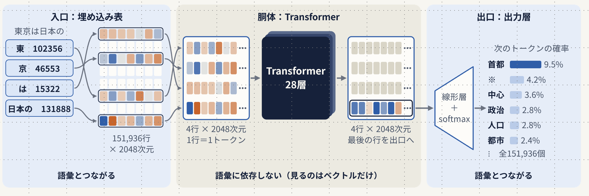
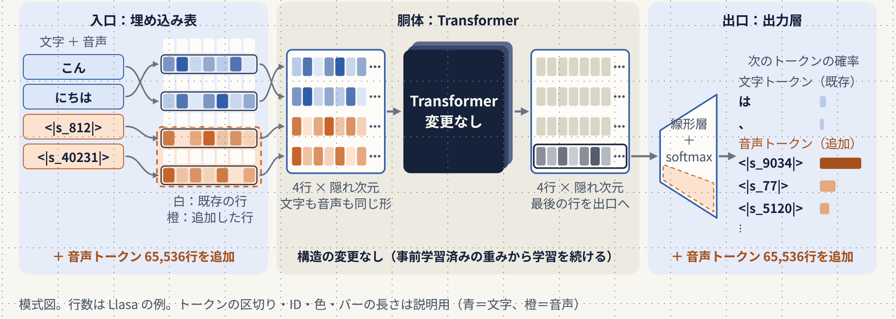
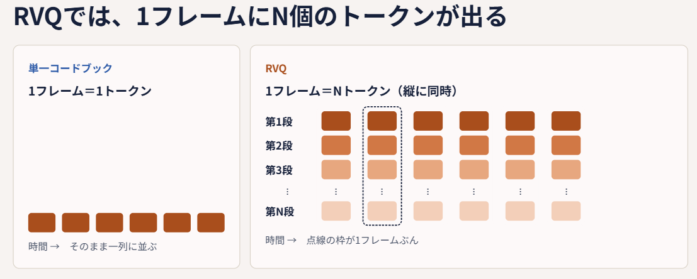

めたん：それでは、いよいよ一番肝心な部分。トークンから次のトークンを予測する仕組み、音声言語モデルの背骨たる「言語モデル」の話をしますわ。

ずんだもん：ストップ、ストップなのだ。ここまで黙って聞いてきたけど、そもそも論として、言語モデルで音声トークンを予測するなんて本当にできるのだ？

つむぎ：たしかに。いくら「Attention Is All You Need」の時代って言っても、文字のトークンと音声のトークンじゃ性質が違いすぎない？ テキストで事前学習したモデルを、そんなあっさり転移学習できるもんかな。

めたん：ふふふ、そこが音声言語モデルの一番面白いところですわ。結論から言うと、驚くほどあっさりできてしまいますの。その理由を理解するために、まず言語モデルの構造を軽く復習しましょう。

## 復習：言語モデルは「入口・胴体・出口」の三段構造

つむぎ：じゃあ復習はあーしが。言語モデルが次のトークンを予測する流れは、だいたいこの三段だよ。

<!-- 図：埋め込み表 → Transformer層 × L → 出力層（LMヘッド） -->

- 入口（埋め込み）：トークンのIDをベクトルに変換する。例えば Qwen3 1.7B の場合、予め決めた辞書のサイズは151,936個あり、それに応じて、埋め込み表もまた151,936行ある。埋め込み表の1行が2048次元のベクトルで、トークン1個につき1行を引いてくるだけ。

- 胴体（Transformer層）：2048次元のベクトル列を受け取って、2048次元のベクトル列を返す。中身には今回は立ち入らないけど、大事なのは2点。入出力の次元が変わらないこと（だから「隠れ次元は2048」と言う）。そして、この部分はトークンのIDを直接見ていないこと。見ているのはベクトルだけ。

- 出口（出力層）：最後に出てきた2048次元のベクトルを、線形層で「語彙サイズ」次元のスコアに写して、次のトークンの確率分布として整えて出力するの。
  
- この流れの繰り返しにより、長い文章も生成できるってわけ。

ずんだもん：要は、語彙とつながっているのは入口と出口だけで、真ん中のTransformerはベクトルとその間の関係性しか見ていないのだ。

つむぎ：その通り。だから、もし語彙を増やしたい場合は……

ずんだもん：埋め込み表と出力層に行を足すだけでよくて、真ん中にはそのままていいのだ！

つむぎ：正解。これ自体は別に珍しい手法じゃなくて、ツール呼び出し用の特殊トークンをモデルに教えるときも、同じ語彙拡張がよく使われてるよ。

めたん：そして胴体のTransformerにとっては、入ってくるベクトルが文字由来か音声由来かは関係ありませんの。「系列の続きを予測する」という課題の形は同じ。ですから、新しく足した行さえ学習できれば、同じ胴体で音声も扱える、というわけですわ。

ずんだもん：あの曲のせいで、この山かっこを直視するがあんまりできないが、この山かっこの中の内容は追加の音声トークンだとね

## 1フレーム＝1トークンの場合：LlasaとMioTTS

めたん：その通りです。この発想を一番素直に実行したのが、2025年に発表された Llasa ですわ。つむぎちゃん、Llama はご存じよね。

つむぎ：もちろん。Meta が公開してる言語モデルでしょ。最近は他のモデルに押され気味だけど。

めたん：Llasa は、その Llama の語彙に音声トークンを65,536個追加して、音声データで学習を続けたモデルですの。1フレームが1トークンのコーデックを使っているから、文字トークンと音声トークンをそのまま同じ一列に並べられますわ。

ずんだもん：モデルの構造はどこを改造したのだ？

めたん：語彙サイズ以外、何も。胴体は Llama のままですわ。

つむぎ：へー、本当に入口と出口だけなんだ。

めたん：ただし、足した行はゼロから学習することになりますから、Llasa は約25万時間の音声データを使っていますの。

つむぎ：構造は「あっさり」でも、データ量はあっさりしてないわけね。

めたん：補足すると、音声トークンを言語モデルに予測させる発想そのものは Llasa 以前からありますの。「単一コードブック＋素の言語モデル」まで削ぎ落としても十分な品質が出る、と示したのが Llasa の意義ですわ。

つむぎ：で、日本語だとどうなの？

めたん：Aratako 氏が2026年に公開した MioTTS がほぼ同じレシピで作られた。コーデックは自作の MioCodec（毎秒25トークン）、ベースの言語モデルも Llama ではなく軽量なモデルに変わっていますが、「単一のトークン列を素の言語モデルで予測する」という骨格は Llasa と同じ。聞いてみましょう。

<!-- Audio：MioTTS の合成音声 -->

めたん：MioTTSの場合、入力のプロンプトは至極シンプルで、ただの文字のプロンプトだけ。
それで、音声トークン生成され。最後にMioCodecで音声のディテールを補完する。

ずんだもん：少しだけノイズっぽいけど、普通に使えるのだ。……でも、ノイズが乗るということは、やっぱり言語モデルに音声を予測させるのは無理があるのではないのだ？

つむぎ：それは早合点じゃない？ 音が出るまでには「言語モデル」と「コーデック」の二段があるんだから、どっちが原因か切り分けないと。

めたん：では切り分けましょう。言語モデルを通さずに、本物の音声を MioCodec でトークンにして、そのまま音声に戻しただけの例ですわ。これは「言語モデルが完璧に予測できた場合」の音、つまりこのシステムの音質の上限にあたります。

<audio controls src="audio/MioTTS/VOICEACTRESS100_001.wav" title="Title"></audio>
<audio controls src="audio/MioTTS/reconstructed.wav" title="Title"></audio>
<!-- Audio：同じ音声を MioCodec でエンコード→デコードしただけの再合成音声 -->

つむぎ：ほらね、同じようなノイズが乗ってる。

<!-- 追加実験案②【優先度：高／手間：小】スペクトログラムで三者比較-->

ずんだもん：なるほどなのだ。言語モデルが完璧でも、この音が天井。ボトルネックは言語モデルではなく、トークナイザー代わりのコーデックの方だったのだ。1フレームを1トークンで表すと、どうしても情報量が足りなくなるのだ。じゃあ、前に説明した RVQ で1フレームに複数のトークンを使えば、もっと綺麗な音が出るのだ？

めたん：原理上はそうですわ。ただ……

つむぎ：今度こそ、入口と出口に行を足すだけじゃ済まなくなる、ってことか。

## 1フレームにN個のトークンをどう収まるか

ずんだもん：そうなのだ。RVQ だと、1つの音声フレームに対して同時に何個もトークンが出てくるのだ。言語モデルは一列の系列しか扱えないのに、どうやってまとめるのだ？

めたん：よくぞ聞いてくれましたわ。どうすると思います？

つむぎ：一番安直なのは、全部のコードブックのトークンを語彙に足して、1フレームぶんのN個をそのまま順番に一列に並べる、とか？

<!-- 図：フラット化。フレーム t の [c1, c2, …, cN] を横一列に展開 -->

めたん：情報を漏れなく入力でき、出力もできますから、原理的には可能ですわ。ただ、系列の長さがN倍になりますの。例えば16段のコードブックで毎秒12.5フレームなら、毎秒200トークン。1秒の音声を作るのに、大きなモデルを200回も回すことになりますわ。

つむぎ：しかも系列が長くなるぶん、Attention の計算もメモリも重くなる。推論時のスピードが足りないか。じゃあどうするんだ。

<!-- 追加実験案④【優先度：低／手間：小】コストの数字を表にする -->

## モデルの二段構え

めたん：RVQ の性質上、前の段で量子化しきれなかった残差を次の段が量子化する仕組みでしたわよね。ですから、後ろの段ほど担う情報量は小さくなりますの。
さらに最近のコーデックは、第1段に「何を喋っているか」という意味的な情報を持たせるよう学習していて、残りの段が声の質感などの音響的なディテールを担当しますわ。

ずんだもん：一番大事なのは第1段で、残りは仕上げということなのだ。

めたん：そこで役割を分けますの。時間方向の流れと第1段のトークンは大きなモデルが予測する。残りの段は、小さな補助モデルが予測する。

つむぎ：出力側はわかった。でも入力側は？ 次のフレームを予測するとき、前のフレームのN個ぶんの情報を全部モデルに渡さないと、情報が欠けちゃうじゃん。

めたん：そこは潜在空間での足し算ですわ。コードブックごとに埋め込み表を用意して、1フレームぶんN個の埋め込みベクトルを全部足して、1本のベクトルにしますの。

ずんだもん：RVQ のデコードも、各段のコードベクトルの足し算だったのだ。同じことをしているのだ？

めたん：形は同じ足し算でも、起きている空間が違うので意味は別物ですわ。コーデック側の足し算は「残差を足し戻すほど元の信号に近づく」と、定義からして精度が上がることが保証されていますの。

めたん：一方、モデル側の足し算は、N個の情報を1本のベクトルに押し込むための操作にすぎない。元のN個を取り出せる理論的な保証はありませんわ。ただ、2048次元の空間は十分に広く、段ごとに別々の埋め込み表を使いますから、区別のつく表現が学習できる。あくまで「経験的にうまくいく」という位置づけですわね。

つむぎ：でも、構造としてはすごく理にかなってると感じるな。要は、この流れでしょ。

<!-- 図：フレーム t-1 のN個の埋め込みを加算 → バックボーン → h_t → 第1段ヘッド ＋ 補助モデル → フレーム t のN個 -->

1. 入力をそろえる：文字は文字トークンの埋め込みに。音声は1フレームN個のトークンを各段の埋め込み表で引いて、足し算して1本に。どちらも2048次元のベクトル1本になるので、「1フレーム＝系列の1ステップ」として扱える
2. 大きなモデル（バックボーン）を1ステップ回して、2048次元の出力ベクトルを得る
3. その出力ベクトルから、線形の出力層で第1段のトークンを予測する
4. 同じ出力ベクトルと第1段のトークンを小さな補助モデルに渡して、残りのN−1個を予測する
5. N個そろったら、また足し算して次のステップの入力にする

ずんだもん：なるほどなのだ。足したものを全体として処理して、最後にまたばらすやり方なのだ。大きなモデルは1フレームにつき1回しか回らないから、一列に並べるよりずっと速いのだ。

## 実例：Qwen3-TTS と Fish Audio S2

めたん：この方式を採っている代表例が、Qwen3-TTS と Fish Audio S2 ですわ。

- Qwen3-TTS（12Hz版）：16段のコードブック、毎秒12.5フレーム。Qwen3 系のバックボーンが第1段を予測し、MTP（Multi-Token Prediction）と呼ばれる小さなモジュールが残り15段を予測する。
- Fish Audio S2：10段のコードブック、毎秒約21フレーム。約4Bパラメータの Slow AR が時間方向と第1段を、約0.4Bの Fast AR が残り9段を担当する。この二段構えを Dual-AR と呼んでいる。

つむぎ：さっきの例でいうと、一列に並べたら毎秒200回必要だった大きなモデルの実行が、12.5回で済むわけだ。補助モデルは毎フレーム回るけど、小さいから軽い。

めたん：細かい違いもありますわ。例えば Qwen3-TTS は、文字と音声を一列につなげるのではなく、同じ位置に重ねて入力する「デュアルトラック」という構成で、文字を受け取ったそばから音声を出せるストリーミング向けの設計になっていますの。それでも「足してまとめ、第1段と残りを分けて予測する」という骨格は共通ですわ。わたくしは、この2つの性能をとても高く評価していますの。

<!-- 追加実験案⑦【優先度：高／手間：中】締めの聞き比べ
目的：前半の MioTTS のサンプルと対になる音を出して、話を回収する。現状はめたんが「高く評価している」と言うだけで音がない。
手順：前半の MioTTS サンプルと同じ文を、Qwen3-TTS と Fish Audio S2 で合成して流す。可能なら参照音声も同じものを使う。
注意：モデルサイズも学習データ量も違うので、「方式だけの差」とは言えない。めたんかつむぎに一言断らせると誠実。 -->

ずんだもん：まとめるのだ。1フレーム1トークンなら、語彙を足すだけの Llasa 型。RVQ で1フレーム複数トークンなら、足し算と補助モデルを組み合わせた二段構え型、なのだ。

## まとめ

音声データと言語データは大きく違うとも、同じ言語モデルを使えば、案外簡単にそのパターンを学習できるものと判明しました。しかし、音声データの表現に、もしRVQのような段数を拡張する手法を使われるとすると、モデルも応じて改造しなければならないです。

参考文献
- Llasa: https://arxiv.org/pdf/2502.04128
- Llasa の日本語ファインチューニング解説（Aratako 氏）: https://zenn.dev/aratako_lm/articles/7e0b0b6e51baa6
- MioTTS: https://huggingface.co/Aratako/MioTTS-2.6B
- Qwen3-TTS Technical Report: https://arxiv.org/pdf/2601.15621
- Fish Audio S2 Technical Report: https://arxiv.org/abs/2603.08823